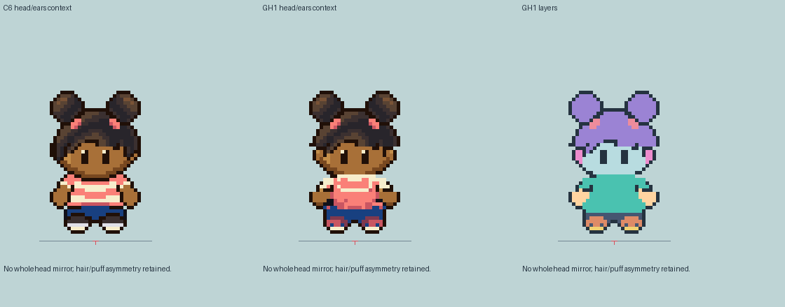
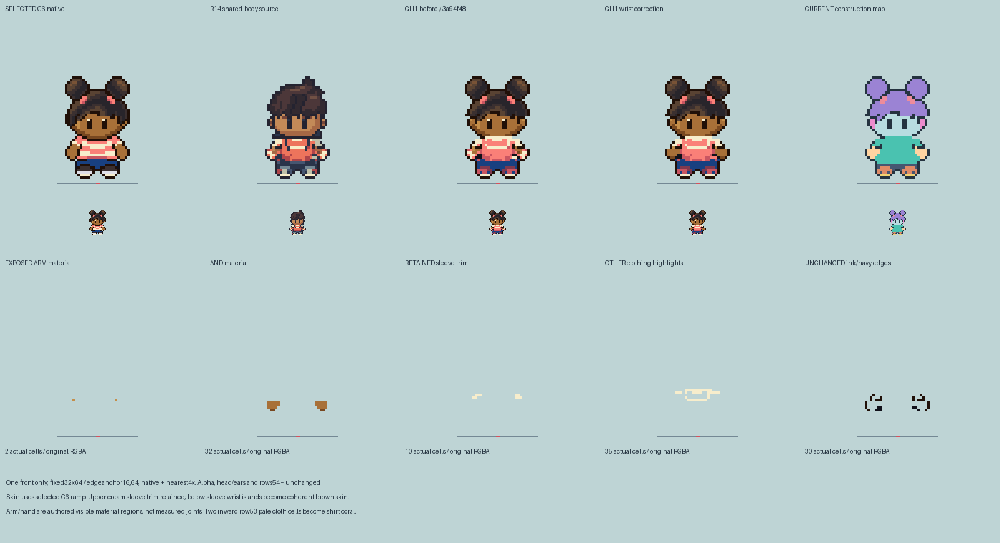

# M1.GH1 — Girl Hero first front idle

**One front idle candidate, independently checked and saved to Library; scoped front-construction pass only.** No other direction or walk has been authored. Review-only original art; existing game assets, saves and deployment are unchanged.

The selected R11/C6 identity remains a ten-year-old Black child with twin natural puffs, coral ties, short temple locks/fringe, coral/cream shirt, blue shorts and burgundy shoes. The native C6 front is also the exact C7 passing still. The separate 24×32 G1/v3 lineage is excluded. The enlarged generated R11 concept supplies design intent only; its pixels are never resampled into the candidate.

## Construction decisions

- Retain original C6 visible head through row44. Its old “skull” annotation includes neck/collar rows45–46; those rows are excluded from the head layer. That inherited scaffold is authored evidence, not observed hidden skull anatomy.
- Change only the bounded ear field to small rounded mirrored ears. Both actual rendered ear patches mirror in RGBA; preserve the original asymmetric puffs, fringe and face outside that field. Paired visible eyes remain two2×4 clusters; no new mouth or nose is drawn.
- Adapt the checked HR14 South idle body layer as a **declared shared visual construction**, retaining its full silhouette, contacts and registration. This is neither a girl-specific observed pose nor proof of hidden anatomy. Do not narrow/tallify the child by gender or expose a neck/leg to explain the costume.
- Restore the selected burgundy shoe material deliberately: C6's native palette had lost it. Existing near-sole color sites become burgundy/coral accents; the pale band remains. No extra shoe pixel or longer foot is added.
- No backpack is added to this selected Girl design. Existing Hero pack corrections remain in HR14. Hidden neck, hip, knee, ankle and anatomical-foot measurements remain unresolved/null.

Canvas32×64, frame-edge anchor(16,64), occupied bounds[3,21,29,62), last painted row61,14 colors. Anchor and painted contact are distinct. All display enlargements use nearest-neighbor integer scaling; no per-character fitting.

## Inspectable deliverables

- [Native candidate](girl-front-idle.png) and [construction map](girl-front-construction.png).
- [Native/4× light and dark comparison](front-native-light-dark.png).
- [Separate actual feature/material masks](front-feature-material-masks.png): hair, puff regions, ties, eyes, ears, hands, near-sole color and pale band. The old authored scaffold is explicitly distinguished from observed anatomy; hair/puff masks exclude tie material.
- [Existing grass/path context](front-world-context.png): original review mock, not a live game/collision test.
- [Editable source and builder](../../../art/source/hero-girl-r1/), separate head/body layers and source hashes in construction.json.
- [29 actual-pixel checks](checks.json) and [two actual Sprite Editor validations](editor-validation.json).

The fixed-frame design/C6/C7/current/HR14 comparison, including the generated concept thumbnail, is external review evidence at `/Users/tanoshi/.codex/visualizations/2026/10/15/girl-hero-preflight/front-identity-comparison.png`. It is excluded from runtime assets. No source game/reference pixels enter the native candidate.

## Review limits and next action

Owner inspected the saved head/join, native/light/dark, material masks, design comparison and world-context plates. The current front has a narrower silhouette below the retained puffed head than C6. The first checkpoint bright cuff/hand issue is superseded by the bounded wrist material correction below; overall stance and balance still need independent visual judgment. Tests prove protection and source consistency, not artistic acceptance. There is no animation/cycle claim for this static checkpoint.

Eutychus reviews this **first front** before any four-direction idles or walks. Broader M1 appearance and M2 movement gates remain open. Do not silently install this candidate or extend the roster. The completed HR14 boy construction/delivery does not grant Girl appearance approval.

Rebuild with the bundled Pillow Python: run `art/source/hero-girl-r1/build.py`, then `present.py` with an external review directory, then `verify.py`. Validate both `.sprite.json` projects with `sprite-editor/model.js`'s `validateProject`.

## Independent review and Library checkpoint — 2026-10-15

Root and the independent reviewer inspected the actual native PNG, enlarged head/body join, light/dark plates, feature/material masks, R11/C6/current/HR14 source-decision comparison and grass/path mock. The old brown row45 and dark row46 bars are absent; the head ends44 and the shirt owns45–46. Selected puffs, ties, fringe and visible eye clusters remain intact outside the bounded mirrored ear patch. Body/contact alpha matches frozen HR14. Burgundy material adds no shoe pixels or sole tiers. No blocking front-construction defect was found. The broad puff silhouette and bright cuffs/hands remain human appearance judgments, not grounds for speculative changes or overall acceptance.

Six Library files at version0 were downloaded and verified byte-for-byte, dimension-for-dimension and RGBA-for-RGBA against their originals. [Exact IDs, hashes and findings](library-review-receipt.json).

- [Native candidate](https://chatgpt.com/api/library/files/libfile_ee812e7232b4819184f51bb2162386b7/download)
- [Selected design/source comparison](https://chatgpt.com/api/library/files/libfile_119966889cac8191b5259a73df76b3ad/download)
- [Head, ears and join](https://chatgpt.com/api/library/files/libfile_ab8c508b93f88191bc2597a26c504560/download)
- [Native/light/dark/context colors](https://chatgpt.com/api/library/files/libfile_7dc7b739250c81919e835407fe705a72/download)
- [Feature/material masks](https://chatgpt.com/api/library/files/libfile_601d2d75dd60819189b2cb007791c8b8/download)
- [Grass/path shared-body mock](https://chatgpt.com/api/library/files/libfile_047ff9adde2c8191aef2e7a9b18ebe01/download)

Automatic approval review rejected the next writer message for three additional directional idle proposals twice. It found that the verified direct human correction authorization did not clearly cover that extension. No new directions were started. Direct approval to message the writer for those three review-only idles is the next dependency; walks, runtime replacement and deployment remain held. This block is distinct from the completed front construction and Library delivery.

## Bounded front wrist material correction

Eutychus/root identified the visible pale/red wrist rings. The existing mapped brown ramp already matched C6; the defect was material ownership, not an inherited lighter complexion. In the audited outer-arm region (x3–9 and22–28, y47–53), the prior image contained only12 skin cells,22 cream,18 coral/shirt-shade,30 ink/navy. Fifteen original HR14 cream plus seven muted fabric pixels had collapsed to bright cream in the Girl mapping.

The correction deliberately authors exposed arm/hand material below the retained upper sleeve. It is **not a global cream-to-skin substitution**:10 cream upper sleeve/trim pixels remain unchanged, as do collar/stripe highlights. The skin region becomes34 cells (32 hand-region cells plus2 arm-region cells), using the selected C6 ramp: base #a87038, upper light #c48e4a, bottom shade #784820. Arm/hand labels distinguish visible authored material regions; they do not establish hidden bones or wrist joints. Two inward pale fabric cells(22,53)/(23,53) become coral shirt fabric, rather than extra skin or a second cuff.

Exactly27 final RGBA cells change, all in the bounded outer region. Every alpha cell, ink/navy edge, head/ear pixel through44 and lower-body pixel from54 down is exact to first-front source3a94f48. The body contour is not redrawn.29 original protection checks, six correction protection assertions and two actual Sprite Editor validations pass. Source/head/body/context/mask plates are regenerated; Library identities/versions remain root-owned and untouched here.

[Before/after actual region materials](wrist-correction/before-after-region-materials.png) · [Exact27 cells, counts, material ownership and protections](wrist-correction/material-decision.json) · [Frozen original first-front PNG](wrist-correction/before.png).

**Awaiting independent review.** Retained outward arm stance/geometry is protected in this color-only correction, not newly approved. No directional continuation, walks, roster, runtime, saves or deployment. Root retains the six Library identities at version0 and will perform guarded replacement after review; the prior Library receipt describes the superseded first-front pixels.
