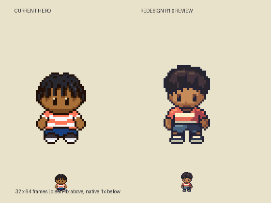
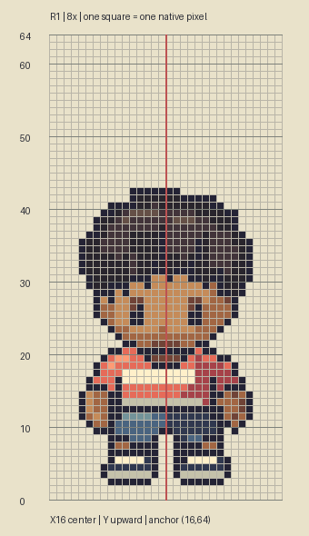

# M1.HR1 — Boy Hero construction redesign

Awaiting user visual review. User authorizes creative liberty on boy Hero and asks for a repeatable character process. This original south idle revises the previously approved appearance as a separate proposal. It does not replace gameplay, animate the cast or claim Emerald equivalence.

The clean plate shows current Hero left, proposed Hero right, both at exact 4× with native 1× beneath. Grid is 8×, one cell per target pixel; X16 center, upward Y0–64. The editable `art/source/hero-redesign-r1/hero-boy.sprite.json` uses the existing Sprite Editor format. `build.py` authors explicit integer polygons/clusters and exports exact pixels; `masks.json` retains the separate hidden construction masks.

## Measurements and evidence

Pinned reference: pret/pokeemerald `5eff78649e7170a877b961ef0b3da13b81a16038`, Brendan normal south idle frame 0, existing source/asset measurements in REFERENCE_MEASUREMENTS. The user-supplied sprite sheet is visual inspection evidence only; no new emulator observation or per-region exact reference measurements were made. No reference pixels or recolored comparison art are included in this packet.

| Property | Reference | Doubled guide | Proposed actual / interpretation |
| --- | --- | --- | --- |
| Frame | 16×32 | 32×64 | 32×64 |
| Full opaque silhouette | 14×21, including headwear | 28×42 | 24×41, short original twists instead of reference headwear; 4px narrower / 1px shorter |
| Idle last painted row | 30 | 61 | 61 |
| Frame anchor | (8,32) | (16,64) | (16,64) |
| Semantic eyes/head/chin | Exact anatomy unresolved in ledger | Not invented | Eyes x11–12 /19–20, rows37–39; exposed chin ends row43; original scaffold |
| Hair | Headwear differs | No literal hat/skull mapping | Rows21–36, deliberately asymmetric locks |
| Neck / shirt / shorts / shoes | Regional exact measures unresolved | No exact-match claim | Neck40–45, shirt42–51, shorts50–56, shoes57–61; occluded envelopes overlap |

Design changes: sculpted short twist crown, narrower cheek/chin read, collar tucked beneath chin, sloping sleeves, material/contact shadows between hands and shirt, coral/cream shirt shaped around body, blue shorts with crotch separation and smaller clipped-corner sneakers. Identity remains a ten-year-old Black boy. The compact body is a new original adaptation under the user's creative-liberty instruction, not a claim to measured reference anatomy.

Validation: exact indexed-source/PNG equality; 32×64; 15 opaque colors; binary alpha; one connected silhouette; unchanged bottom anchor; two transparent bottom rows; mirrored face/neck/shirt/shorts masks and reflected arm/leg/shoe pairs. Clean native/4× and countable grid visually inspected; eye highlights and shoe corners revised after first inspection. Technical checks establish usable pixels, not artistic acceptance. Front only: profile/back and motion remain unproven.

Static review only, playable build unchanged. Exact next action: user judges front-idle direction; revise it or use this accepted construction to author side/back before any walk production or gameplay replacement.
