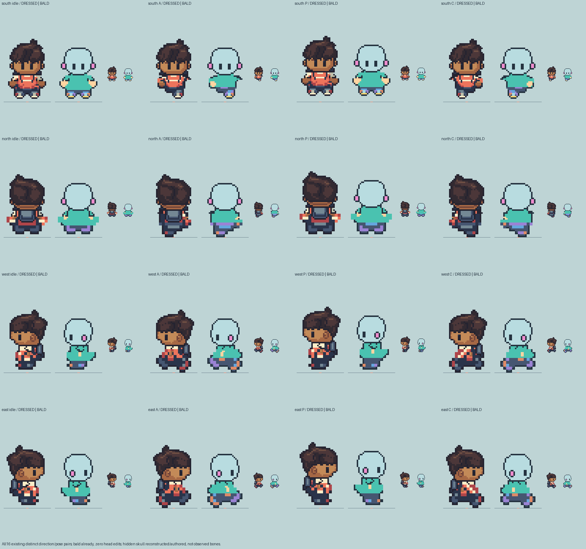
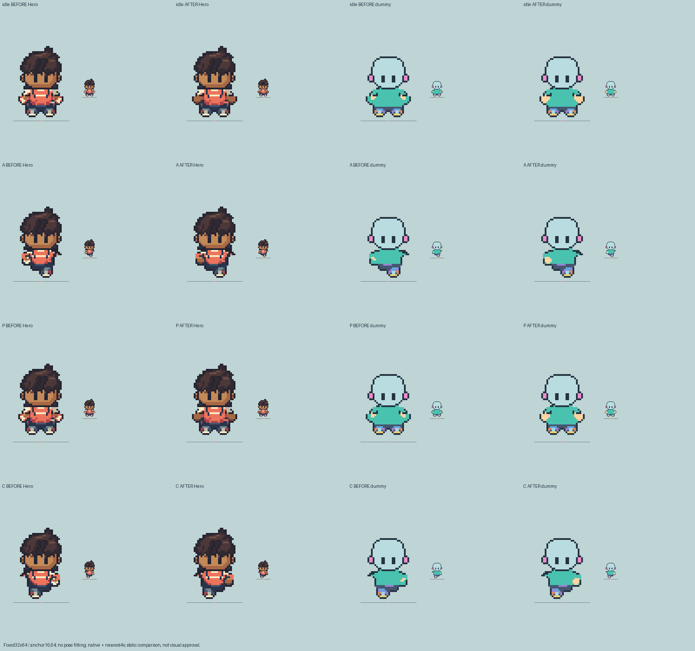

# HR14 bald foundation and bounded front wrist correction

**Independent scoped bald/hand foundation construction pass; concrete parent checkpoint delivered.** Existing poses only; no creator, new direction, roster, runtime/save or deployment change. All Girl files remain byte-exact during this pass. The user's later direct Girl-continuation authorization remains recorded in the chat; Eutychus sequences further expansion after the separate dummy foundation review.

## Bald reusable dummy: already correct, zero head edits

Owner inspected every distinct direction/pose pair, native and nearest enlarged. All16 existing dummy head combinations have a smooth crown without hair, fringe, crest or headwear. Their actual head pixels use only pale head, dark edge/eyes and pink ear materials; their reconstructed crown pixels are exact to the original HR13 authored bald heads. These are **authored reconstructed contours**, not source-observed hidden skull anatomy. Existing eyes, visible ears, head-over-torso occlusion and no-mouth default are retained. No dummy head pixel was changed. Dressed Hero hair stays exact.

No anatomical feature swapping/customization prototype or body variants started. A future approved creator must treat hair/headwear as separate overlays; no hair silhouette belongs on the reusable base.

## Front material decision

The selected Hero skin ramp was already #a66845/#c38a58/#744539; the problem was not a new complexion. Bright cream/muted fabric and coral islands around small brown sites obscured the hand read. This bounded pass explicitly assigns below-sleeve outer material to coherent skin, retaining upper sleeve/collar/stripe fabric. It never makes all white sleeves skin.

| Existing front pose | Changed Hero color cells | Material decision |
| --- | ---: | --- |
| idle |27|Below-sleeve skin, upper light/bottom shade; two inward fabric sites(22,53)/(23,53) become coral cloth.|
| P |27|Same idle construction translated2px upward; fabric sites at row51. Exact seam53 remains protected.|
| A |10|Existing visible hand region x6–9, rows50–53 uses coherent selected skin; ink/navy pixels protected.|
| C |10|Mirrored existing hand-region material decision; no bag/head mirroring.|

The neutral dummy's actual exposed-hand color regions follow the corrected Hero cells. Upper cream/muted trim remains cloth; other clothing highlights remain separately masked. These labels are **authored visible-material ownership**, not measured wrist/elbow/bone geometry. Lower materials and all hidden joint uncertainties are unchanged.

[Exact cells, counts, actual masks and protections](checks.json) · [Before/after all unique front poses](south-before-after-allunique.png) · [Separate actual skin/trim/highlight/edge masks](south-actual-skin-trim-highlight-edge-masks.png).

All alpha/ink/navy edges, dressed Hero heads, bald dummy heads, lower RGBA54+, P seam53, frame32×64/anchor16,64, order/ticks, contacts and canonical/visible pack/strap layers remain exact. Source P/idle upper interface remains exact under its existing2px translation. North/west/east native PNG/GIF/source files and Girl source/review files match the frozen before hashes. [Frozen hashes](before-hashes.json) preserve both original HR14 and GH1 evidence independently.

## Current loops and verification

- [Local normal/slow native/4× preview](preview.html): four directions, existing eight slots only. `python3 -m http.server 8786 --bind 127.0.0.1 --directory docs/reviews/M1-HR14/wrist-correction` serves it locally when needed.
- Front synchronized before/after [native](south-before-after-1x.gif) / [4×](south-before-after-4x.gif).
- Four direction `{direction}-dressed-bald-{normal,slow}-{1x,4x}.gif` files show dressed Hero and bald dummy together. All8 frames decode pixel-exact; front800/3200ms, other540/2160ms export holds retained.
- Reference-bearing source/before/after all-unique/8-slot native/4× proofs remain external at `/Users/tanoshi/.codex/visualizations/2026/10/15/hero-hr14-review/`, filenames `south-source-before-after-*`. Idle source is explicitly P; true idle is unobserved. No reference art enters the build.

[Scoped actual-pixel checks](checks.json):4,697 assertions, including protected features/layers, bald crown audit, untouched Girl/NWE inputs and exact editable frames. [Export checks](export-checks.json):32 native poses connected/binary-alpha,28 existing GIF exports exact pixels/holds, idle/P interface exact. Actual Sprite Editor validates all10 editable projects. Sixteen new dressed/bald diagnostic loops plus two before/after loops decode8 exact frames; two source-bearing comparison loops stay external.

Owner inspected saved material/all-unique/bald plates and two actual browser screenshots of current normal/slow playback. This is sampled browser evidence, **not an uninterrupted human full-watch claim**. The prior rendered-cycle trace and Library receipts remain historical c98a8cb/frozen-before evidence; they do not establish the corrected south export SHA or current appearance acceptance. Root retains Library identities and performs guarded replacements/regenerates derived rotation QA after independent review. No Library write was performed here.

Exact next action: independent **bald dummy foundation and corrected front hand** gate review. Keep creator and broad roster/Girl directional expansion unstarted until that sequencing checkpoint is confirmed; no final art or movement approval is inferred from tests.

## Independent frozen gate and Library delivery

Source `bae462f` / frozen receipt `3e0937c8` match the independently inspected pixels and current normal/slow GIF hashes. The reviewer found coherent brown hand clusters with actual sleeve trim kept above them; no new alpha/head/foot/edge/pack defect. All16 bald heads remain exact, with no spikes/fringe/puffs or headwear; their contours are authored reconstructions. Dressed Hero hair stays protected. This is a scoped foundation result, not automatic appearance/runtime acceptance.

A fresh independent native `` browser trace captured179screenshots over14seconds, all exact current exported pixels, with16complete normal and3slow A→P→C→P→A cycles and zero unmatched panels. Root and independent reviewer inspected both actual captured-cycle contact plates. [Current trace](current-render-trace.json). Captures stay external under `/tmp/hr14-bald-motion-2KXAoF`; no browser captures were uploaded. This is rendered-cycle evidence plus visual phase/transition inspection, **not uninterrupted human watching**. N/W/E art and timing are byte-exact to the previously traced source; the new trace covers changed South only.

Twenty-two Library downloads match bytes, dimensions, every RGBA frame and GIF timing/loop. Seventeen existing identities received guarded replacements: seven affected prior Hero/dummy proofs and all ten rotation/phase comparisons. Five new version0 plates/loops provide the bald foundation and before/after decision. [Authoritative current IDs/versions/hashes](library-review-receipt.json). Earlier source-material sheets that were not regenerated remain explicitly historical before-correction evidence; they cannot establish current wrist colors.

- [All directions/poses: dressed Hero versus bald dummy](https://chatgpt.com/api/library/files/libfile_61a274d45a408191a8abdc568fd1d672/download)
- [Front idle/A/P/C before and after](https://chatgpt.com/api/library/files/libfile_dc1ee3cefff48191ab87c3ba3d835b5f/download)
- [Actual exposed-skin / sleeve-trim / clothing-highlight / edge masks](https://chatgpt.com/api/library/files/libfile_75aea12115408191b6fc0ef0f86ee010/download)
- [Native dressed/bald walking](https://chatgpt.com/api/library/files/libfile_3ec4c60f83fc819191bb2d24582d7088/download)
- [Native before/after walking](https://chatgpt.com/api/library/files/libfile_4aabe43cf64881919b1dab09c43fe053/download)
- [Updated four-direction native phase comparison](https://chatgpt.com/api/library/files/libfile_9cf56acdcab081919facd35975864287/download) / [nearest4×](https://chatgpt.com/api/library/files/libfile_8d68c152a1d481919a781bb5d94d4428/download)

The renewed user authorization resolved the specific writer handoff blocker; it is no longer accurate to say that hand correction cannot proceed. The latest user priority is dummy foundation first, then a bounded registered character-creator prototype. **Creator implementation has not started**: parent receives this gate evidence before expansion. Future optional hair/headwear must be independent overlays outside the bald base; no-mouth default and starter clothing remain. No body-type expansion, broad roster work, runtime/save change or deployment occurred. Parked edits preserved.
