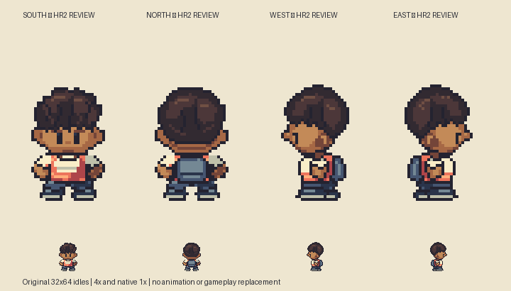
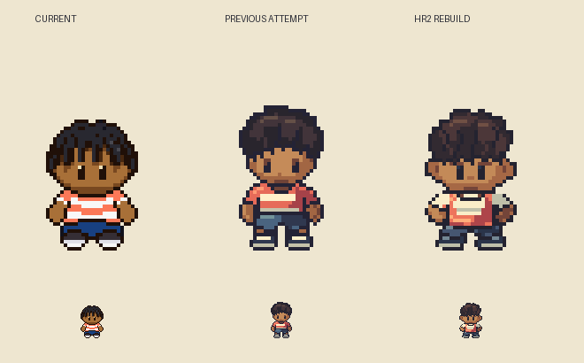
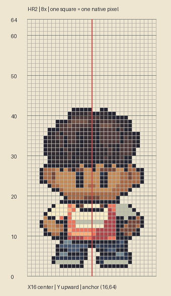

# M1.HR2 — Reference-led boy Hero reconstruction

**Original native directional-idle deliverable complete; awaiting user visual review.** User rejects HR1 as still missing Emerald's construction, authorizes a disciplined reference-based reconstruction and asks for persistence. HR1 remains rejected/superseded review history. Current gameplay Hero is preserved.







## Actual reference inspection

[Brendan walking.png](https://github.com/pret/pokeemerald/blob/5eff78649e7170a877b961ef0b3da13b81a16038/graphics/object_events/pics/people/brendan/walking.png), pinned revision `5eff78649e7170a877b961ef0b3da13b81a16038`; SHA256 `f33ec07a5fd17f4422455f8bc55cd3d3522fa65c3bf740ecbdc00da705eaa0d1`. Downloaded and hash verified in this task; inspected the nine-frame strip and front/back/profile idles 0/1/2. Palette index0 is transparent. This is native source inspection, not emulator observation. Anatomical boundaries obscured by hats/clothing remain uncertain.

[Matched reference plate, local and excluded from build](/Users/tanoshi/.codex/visualizations/2026/10/13/hero-hr2-reference/matched-reference.png) shows reference at exact2× beside original32×64 Critz at1×, then identical3× display enlargement and native comparison. Horizontal guides are top-down target rows38,46,56,62. Reference images never enter the repository or production authoring script. The checked-in comparison script reads an external reference directory and writes reference composites only there; numeric evidence stays in this packet.

## Measured corrections

HR1 starts the neck/shirt around row42 and expands legs/shoes upward from57. The reference chin reaches44–45, shoulder band starts46, central torso occupies46–55 and lower body fits56–61. HR2 rebuilds around those reference-derived placement guides instead of merely matching overall height. Original clothes overlap those bands, so annotation-window bounds must not be described as exact anatomical cuts.

| Visible front band / landmark | Reference pixels | Exact2× guide | HR2 actual / deviation |
| --- | --- | --- | --- |
| Full figure |14×21 incl. headwear|28×42|26×40; narrower ears, short twists; not hat-equivalent anatomy|
| Eyes |x6/x9, y19–20|[12,38,14,42] / [18,38,20,42]|Exact visible16-cell paired eye mask|
| Headwear band |[4,20,28,36] doubled|24×16|[4,22,28,36] within band; crown2px lower|
| Face/ear band |14×5|[2,36,30,46]|[3,36,29,46]; ears1px inward each side|
| Shoulder band |12×1|[4,46,28,48]|[5,46,27,48];1px inward each side|
| Central torso window |6×5|[10,46,22,56]|Same occupied bounds in window|
| Arm/hand windows |4×4 each|[2,46,10,54] / [22,46,30,54]|[3,46,10,54] / [22,46,29,54]|
| Lower body band |10×3|[6,56,26,62]|Same occupied bounds in window|
| Foot/anchor |last row30 /(8,32)|last row61 /(16,64)|Exact in all four original idles|

`reference-measurements.json` records independently measured annotation windows and deviations. These bounded windows include clothing/outline overlap and cannot prove identical body geometry. Symmetric Critz skull/face construction is original; hidden reference skull is not claimed measured.

## Drawing and refinement

Independently authored target-grid polygons and pixel clusters rebuild the figure; no recolored, traced pixel mask or resized reference enters the authoring generator. The original Black ten-year-old Hero retains coral/cream, blue shorts and natural hair. A small slate daypack, inset chest panel and cream sleeves supply readable original costume surfaces. Dark contacts separate jaw/collar, sleeve/hand and shorts/shoes; feet occupy a compact grounded band. Profile nose/ear/neck and rear daypack placement are explicit views rather than turning the front face sideways. East stores a reflected bilateral profile scaffold with separately corrected lighting.

IterationA is preserved in `iteration-a.png`. Source comparison prompted a second hair pass: shorter notched crown, connected twist separators, lower fringe without obscuring eyes; consolidated sneaker accent to keep15 opaque colors. Front differs from both current Hero and HR1 in landmark placement and body occupancy. Native and enlarged matched reference, clean four-direction, before/after and countable grid inspected. No claim of user acceptance or perfect Emerald equivalence.

## Editable delivery and verification

`art/source/hero-redesign-r2/hero-boy.sprite.json` opens in the actual Sprite Editor; `hero-boy.rle.json` is its exact RLE export. `masks.json` preserves separate construction regions including visible eyes. Four native transparent PNGs stay separate from all overlays.

`build.py` reproduces original-only assets/plates. `verify.py` independently decodes saved source/PNGs and checks binary alpha,15 opaque colors, exact pixels, bottom transparent rows, front/back paired anatomy and unobscured eye masks. The generator separately checks one connected silhouette per frame and common registration. Actual Sprite Editor `validateProject` accepts all four frames. No gameplay tests needed: runtime, maps and saves have no changes.

Reproduce with Python/Pillow:

```
python build.py
python verify.py
python compare-reference.py /absolute/external/reference-folder
```

The last folder must contain the pinned `walking.png` and must be outside the project. Reference PNG/comparison outputs remain there. Scripts are resolved from this source directory; no emulator or user browser storage is accessed.

Static art review only: no gameplay integration, animation, Sites deployment or wider gate acceptance. The phone game continues its existing published version. Exact next action: judge this matched-scale appearance; resolve any remaining silhouette/face/costume changes, then map walking key poses to the actual source within the accepted directional construction. Do not extrapolate HR1 or a generic doll template to the cast.
