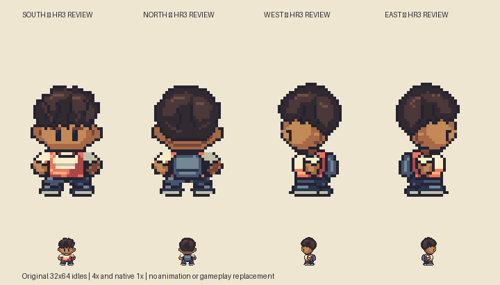
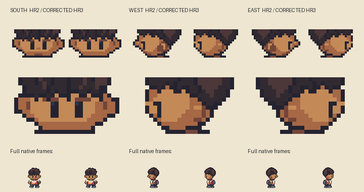
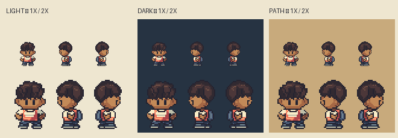
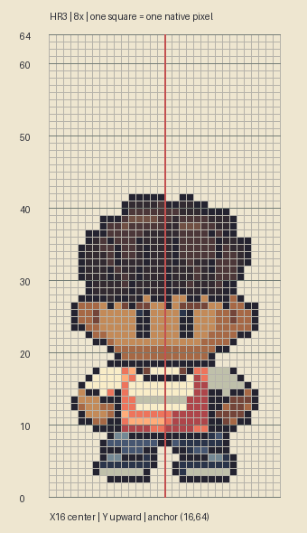

# M1.HR3 — Boy Hero facial-shape correction

**Requested nose correction complete; corrected directional artwork awaits user visual acceptance.** User approves the broader direction but rejects the projecting nose and requests continued self-checking. This delivers corrected front/west/east with exact unchanged north, retaining original Black child Hero identity and HR2's reference-led body construction. No cast expansion or gameplay replacement.

## Correction and actual verification

Removed the explicit west-profile nose points at `(4,38)` and `(5,40)` and redrew a continuous forehead/cheek contour. East stores the corresponding opposite profile. Removed the two center-face nose-shading pixels and frontal mouth cluster; simplified the oversized dark profile cheek patch into a small attached ear with restrained shading. Direction reads through eye position, hairstyle, ear, collar and costume depth. Skin ramp stays unchanged. Front-facing visible eyes remain `[12,38,14,42]` and `[18,38,20,42]`. No lips or nose are separately drawn.

First saved exports were inspected in a clean four-direction plate, then cropped before/after faces, native backgrounds and reference/grid views. No remaining projecting profile feature or isolated central frontal cluster was observed in these inspections. `face-checks.json` independently records actual saved-PNG left contour rows35–41 as `[6,6,6,6,6,6,7]`, and the right as `[25,25,25,25,25,25,24]`: neither has a local outward nose point. This is a specifically defined visible-contour check, not a mathematical measure of beauty or a universal facial rule.

All original HR2 body pixels from row46 down are exact in every view. North PNG is byte-identical. Every saved PNG exactly matches its indexed source; all four remain connected, binary-alpha, at most15 opaque colors,32×64 with common `(16,64)` anchor and transparent rows62–63. Front/back anatomical pairs and unobscured paired eye masks pass. The actual Sprite Editor `validateProject` accepts all four frames; exact RLE is exported. Diff check passes. No runtime tests were needed for static art-only changes.

## Reference and editable deliverable

Pinned basis remains Brendan walking.png at `5eff78649e7170a877b961ef0b3da13b81a16038`, SHA256 `f33ec07a5fd17f4422455f8bc55cd3d3522fa65c3bf740ecbdc00da705eaa0d1`. Read-only source hash/annotation-window analyzer rerun against the actual external PNG. Existing seven front windows/landmarks remain unchanged by the face correction. Source inspection only; no emulator/movement validation. Hair, face, costume and pixel drawings are original Critz adaptations, not copied reference rasters. Profile nose-free contour is the user's new Critz direction, not claimed exact reference anatomy.

[Matched reference comparison, outside build](/Users/tanoshi/.codex/visualizations/2026/10/13/hero-hr3-reference/matched-reference.png). HR2's reference plate was regenerated in its original external directory to preserve historical comparison; HR3 gets its own separate directory. No reference imagery is checked in.

`art/source/hero-redesign-r3/hero-boy.sprite.json` and `hero-boy.rle.json` are editable in the existing Sprite Editor. Native exports: `hero-south.png`, `hero-north.png`, `hero-west.png`, `hero-east.png`. Separate masks and explicit integer drawing source retained. `build.py`, `verify.py`, `check-faces.py` and optional `compare-reference.py EXTERNAL_FOLDER` reproduce assets and actual checks with Python/Pillow. The optional reference folder must stay outside the project and contain the pinned `walking.png`.

## Repeatable lesson

Begin small overworld faces with a quiet skin plane and paired readable eyes. Add a facial mark only when the intended native-scale design needs it; inspect both its contour and shading in every direction before retaining it. Profile direction does not require a protruding nose. Compare native and enlarged clean versions, then inspect a countable grid; use saved-pixel tests for exact defects and invariants, and visual inspection for the appearance. Do not introduce distinctive facial exaggeration while adapting a reference hairstyle or skin ramp.

Static review deliverable only: main gameplay Hero, maps, saves, animation and hosted phone build are unchanged; no Sites deployment required. Exact next action: review corrected direction; walking key poses or replacement of accepted gameplay artwork require their own authorized deliverable and checks. No wider visual gate is self-approved.
