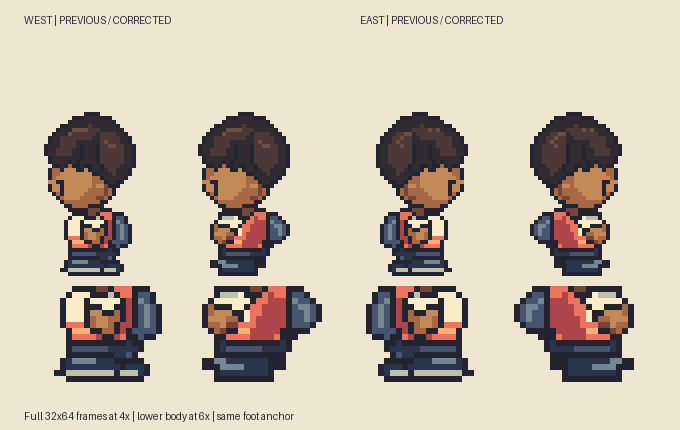
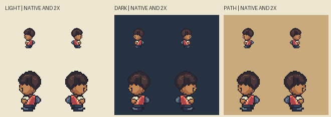
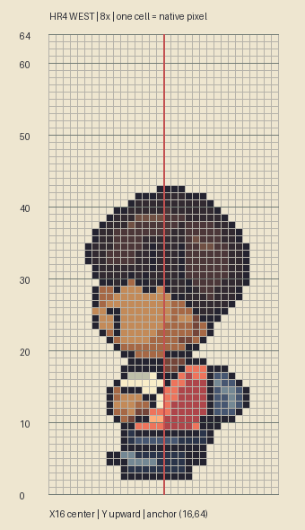

# M1.HR4 — Compact profile feet and limb overlap

**Correction implemented and checked; awaiting user visual review.** The user points out that HR3's profile feet are long, flat and unlike the actual Emerald reference, and that the overall profile shapes remain wrong. This revision corrects the visible lower-body row shapes and arm/body overlap, rather than merely rechecking frame/anchor dimensions.

## Diagnosis and correction

HR3 placed the far shoe behind the near shoe as two long, nearly parallel soles. Bright cream bands further extended their apparent length. Its hand was centered too far back on the torso; backpack projection continued too low. Matching the foot baseline and a coarse region bounding box did not detect any of these errors.

HR4 tucks the far foot behind the near shoe and under the hips, shortens the heel, narrows the contact rows, replaces long bright sole bands with one restrained short material accent, moves the arm forward and shortens the backpack's bottom. A second pass narrows the hand/cuff and corrects an extra heel pixel found by the saved-PNG row check. The final review compares original source, HR3 and HR4 at identical apparent pixel scale and anchor.

Pinned reference remains `pret/pokeemerald` revision `5eff78649e7170a877b961ef0b3da13b81a16038`, `graphics/object_events/pics/people/brendan/walking.png`, profile idle frame2, SHA256 `f33ec07a5fd17f4422455f8bc55cd3d3522fa65c3bf740ecbdc00da705eaa0d1`. Actual indexed source is hash-verified and inspected again. Source-only analysis, no emulator/frame observation. [External profile comparison](/Users/tanoshi/.codex/visualizations/2026/10/14/hero-hr4-reference/profile-reference.png) and [three-view comparison](/Users/tanoshi/.codex/visualizations/2026/10/14/hero-hr4-reference/matched-reference.png) stay outside the project/build. Original Critz source uses manual target-grid geometry, not imported reference pixels.

## Actual saved-pixel measurements

Top-down target rows. Counts refer to occupied lower-body silhouette rows, not hidden anatomy. The reference has been doubled exactly; Critz uses native32×64. `profile-checks.json` records every row46–61, including absolute left/right edges, rather than just widths.

| Row | Emerald2× occupied width | Previous HR3 | Corrected HR4 |
| --- | --- | --- | --- |
|56|12|13|13|
|57|12|12|12|
|58|14|14|14|
|59|14|15|14|
|60|10|16|10|
|61|10|13|10|

The final four lower-body rows58–61 now match the reference's absolute occupied intervals `[8,22)`, `[8,22)`, `[10,20)`, `[10,20)`. The shorts boundary at56 intentionally retains a1px original deviation; upper body/costume remain original adaptations. These specific checks establish removal of the long sole defect, not complete stylistic equivalence. Initial commentary described16px as the bottom contact; exact measurement distinguishes the penultimate row60(16px) and last row61(13px).

Front and back PNGs are byte-identical to HR3. Every profile pixel above row46 is exact, preserving hair, eyes, skin, nose-free contours and chin. Common `(16,64)` registration, empty bottom rows,15 opaque colors, binary alpha, connected silhouettes, opposite profile lower-body registration and exact indexed-source/PNG export pass. Actual Sprite Editor validator accepts all four idles and produces exact RLE. Final saved PNGs and clean4×/6×, native1×/2× light/dark/path, external matched reference and full8× profile grid were inspected. No self-approval of visual/movement gates.

## Source, checks and delivery

`art/source/hero-redesign-r4/hero-boy.sprite.json` and `hero-boy.rle.json` reopen in the existing Sprite Editor. `masks.json` retains construction regions; `build.py` reproduces original-only assets, `verify.py` independently verifies saved exports, `check-profiles.py EXTERNAL_REFERENCE_FOLDER` checks protected pixels/row geometry and creates focused plates, and `compare-reference.py EXTERNAL_REFERENCE_FOLDER` reproduces the external comparison. Python/Pillow required; the external folder must contain the pinned `walking.png` and must stay outside the repository.

`iteration-a.png` preserves the first corrective shape before narrower cuff/final heel correction. HR3 remains historical evidence. Generic unchanged front comparisons are omitted from this profile-focused packet.

Static review only: gameplay assets, maps, animation, saves and hosted build unchanged; no deployment is required. Unrelated concurrent Tanoshi eye/bear sources and documentation are preserved and excluded from the Hero commit. Exact next action: user judges the corrected profile proportions; remaining directional/animation work must use this row-shape and overlap review, not frame dimensions as a proxy for appearance.
