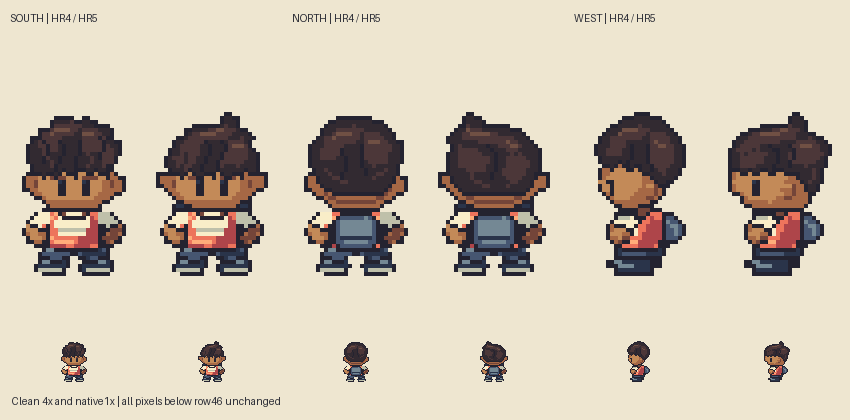
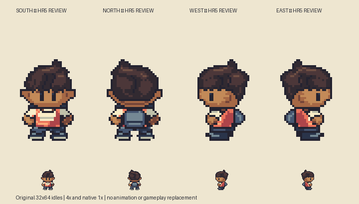

# M1.HR5 — Actual head overlay and silhouette correction

**Head correction implemented and checked; awaiting user visual review.** User rejects the obvious HR4 head-shape mismatch and explicitly requests overlaying Hero directly on Brendan. This revision performs that actual same-scale overlay before and after reshaping all four original Hero heads. The prior dome was too centered and broad high up; the profile lacked lower-head mass and its eye was too far forward.

## Actual overlay, not a side-by-side substitute

[Before/after 50% overlays and clean correction](/Users/tanoshi/.codex/visualizations/2026/10/14/hero-hr5-reference/before-after-overlay.png).

[Reference / original Hero / actual50% overlay / silhouette difference, all three reference views](/Users/tanoshi/.codex/visualizations/2026/10/14/hero-hr5-reference/head-overlay.png).

All sprites align by their full32×64 frame and common `(16,64)` anchor. Reference16×32 frames are doubled with nearest neighbor. There is **zero per-sprite translation, scaling adjustment or independent crop registration**. Head crops are the same shared rows18–47 after alignment; numeric comparison uses rows20–45. Red is Hero outside reference, blue reference outside Hero, green shared opacity. The alpha composite is a literal source-over50% Hero layer over Brendan, not a labeled clean image. Reference pixels stay in the external directory, never the repository/build.

Pinned input: `pret/pokeemerald`, revision `5eff78649e7170a877b961ef0b3da13b81a16038`, `graphics/object_events/pics/people/brendan/walking.png`; SHA256 `f33ec07a5fd17f4422455f8bc55cd3d3522fa65c3bf740ecbdc00da705eaa0d1`, verified from the actual input. Frames0/1/2 are front/back/west. Source inspection only, no emulator observation. Reference headwear and original hair differ; no hidden skull shape is claimed measured.

## Diagnosis and changes

The overlay shows more than a different hairstyle: HR4's upper crown mass was centered like a ball while the source sweeps sideways and gains width lower down. Its lower profile head shrank too sharply into the neck. Matching only painted bounds, eye height or selected foot rows missed the combined silhouette.

Rebuilt original short twists into a low swept crown with a small offset crest, connected sloping highlight clusters and fewer circular pads. Broadened the lower profile face/back-hair mass, corrected the blunt ear/cheek contour in front/back, and used a narrow dark jaw/collar overlap rather than inflating the exposed chin to fill the entire reference silhouette. The source's hidden anatomy is not inferred from the cap. Profile eye is now `[10,38,12,42]`, based on the identified visible source eye at `(5,19)…(5,20)`; front eye rectangles remain unchanged. Both profiles retain continuous forehead-to-cheek contours with no projecting nose.

All body pixels from row46 down are **exact HR4** in all four views. This includes the corrected short profile feet, arm/cuff/backpack overlap, front/back clothes and stance. Black child identity and the existing skin palette remain.

## Measured overlay evidence

`head-overlay-checks.json` independently reads the saved PNGs and actual external reference, recording every head row's absolute left/right/occupancy and before/after set differences. The comparison region includes headwear/hair, ears, visible face and jaw contact; it is not a semantic bare-skull mask.

| View | HR4 extra+missing occupied head pixels | HR5 extra+missing | Intersection/union before → after |
| --- | --- | --- | --- |
|Front|86|27|84.1% →94.7%|
|Back|81|20|85.1% →96.2%|
|West|118|31|77.7% →93.9%|

These numbers substantiate reduced silhouette mismatch, **not artistic acceptance or a percentage of overall Emerald quality**. Remaining differences include original twists versus cap/visor points and the explicitly requested nose-free contour. Original design is independently drawn target-grid geometry; no reference raster/mask is ingested by the authoring generator.

Actual clean native/4× views, aligned overlay/difference maps, original-only before/after and8× profile grid inspected. The crown/cheek/eye changes are visible at native size. Saved-source/PNG equality,15 opaque colors, binary alpha, connected silhouettes, full body preservation, symmetric front/back construction/jaw-contact masks, unobscured front/profile eyes, non-projecting profile contours and bottom-row/anchor checks pass. Actual Sprite Editor `validateProject` accepts all four frames and exports exact RLE. No runtime checks needed for static-only art.

## Reproduce and continue

Sources: `art/source/hero-redesign-r5/hero-boy.sprite.json`, `hero-boy.rle.json`, `masks.json`, explicit native authoring script. `build.py` and `verify.py` reproduce original-only outputs/checks. `check-head-overlay.py EXTERNAL_FOLDER` performs actual overlays, row/set analysis and preservation/visible-eye/contour checks; `compare-reference.py EXTERNAL_FOLDER` supplies the earlier full-body comparison. Python/Pillow required. The external folder must contain the pinned `walking.png` and stay outside the project.

[Countable profile grid](hero-grid.png) has one native pixel per cell, X16 centerline and upwardY0–64. Native PNGs contain no guides.

Static review only: gameplay Hero, animation, maps, saves and hosted build unchanged; no deployment required. Exact next action: review this corrected head using the actual overlay; future animation/cast work must use the same full-silhouette overlay before delivery. No wider visual gate self-approved.
