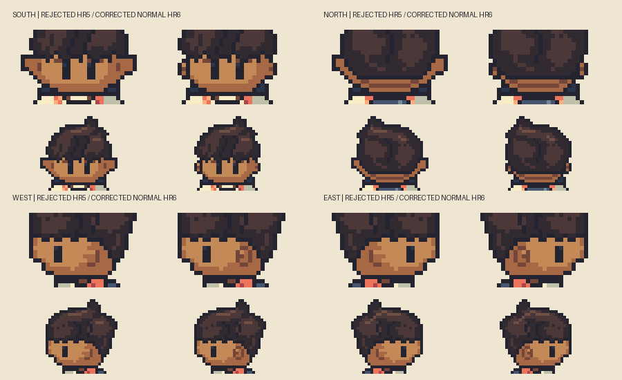
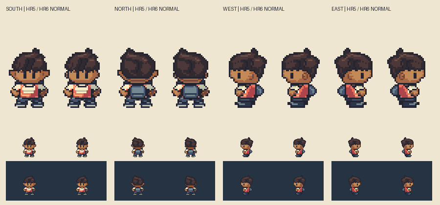
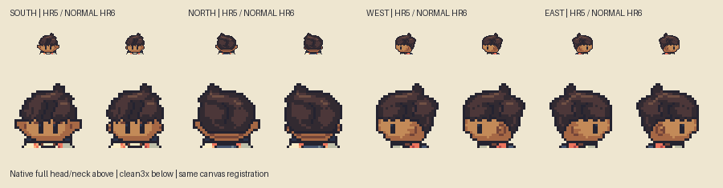
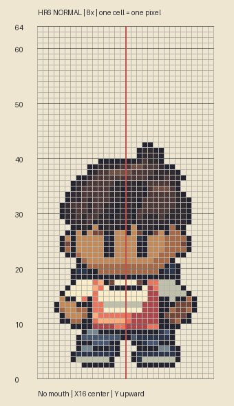

# M1.HR6 — Stage1 normal-default human-ear checkpoint

**Stage1 review deliverable implemented and checked; awaiting Eutychus/Phil visual response.** Existing sole Hero writer continues from clean main `2bec468`. User rejects HR5's broad front wedges and requests small rounded human ears, no mouth by default, and staged future customization. This checkpoint corrects the normal default only. No fat/skinny drawings, feature-swapping implementation, customization UI, animation or gameplay replacement.

## Evidence and corrected construction

Inspected the actual supplied screenshot `/tmp/hr5-ear-reference/Screenshot 2026-10-14 at 5.04.17 PM.png`,53,414 bytes; SHA256 `f00f56517c51f2f53ea0c9a01699b031d5e4c0dd2ccacf12151a6c61d6d1b5f9` verified locally. HR5's front ears were vertices in one large face/cheek polygon. Its long horizontal top edge and diagonal return created elf-like wedges; matching Brendan's aggregate silhouette had preserved the wrong original anatomy. HR5 is rejected history, not an accepted base.

HR6 separates left/right ear masks from the normal face scaffold. Each full front/back lobe is4×5 including its contour, clipped at corners and attached to the side of the head rather than tapering into a wide cheek wing. The inner edge joins the face; the hair occludes the upper/inner portion. Same paired geometry front/back; view-dependent hair occlusion is explicit. The near profile ear uses the same4×5 full scaffold with restrained inner shading, while the far ear is hidden. All are proposed original Critz construction, not claims of measured human/Brendan anatomy.

| Direction | Full ear scaffold bounds, half-open target coordinates | Visible extent after face/hair occlusion |
| --- | --- | --- |
|South left/right|[4,37,8,42] / [24,37,28,42]|3×5 bounding region,9 cells each|
|North left/right|Same paired bounds|3×4 bounding region,8 cells each|
|West near|[18,38,22,43]|4×5 bounding region,16 cells|
|East near|[10,38,14,43]|4×5 bounding region,16 cells|

### Bounded edit and cheek decision

The narrower front/back cheek contour is deliberate: the old single face polygon used its lateral wedge as both ear and cheek. HR6 replaces that with a rounded face scaffold plus separate attached ear lobes. The retained hair, eye line and lower jaw/neck registration establish the same head; the ears no longer determine the cheek slope. This local anatomical correction takes precedence over matching the cap-inclusive reference silhouette.

| Direction | Allowed changed region | Actual changed bounds | Changed pixels |
| --- | --- | --- | --- |
|South|[2,36,30,46]|[2,36,30,44]|44|
|North|[2,36,30,46]|[2,36,30,45]|37|
|West|[17,38,22,43]|same|16|
|East|[10,38,15,43]|same|16|

**Every saved pixel outside these direction-specific allowed regions is byte-exact HR5**, including original hair colors/geometry, neck/body below46, outfit and feet. Explicit empty mouth/nose masks are verified; the saved front center-face rows have no isolated lip/nose cluster, and the profile nose/mouth facial regions are pixel-exact HR5. All113 changed pixels stay within the bounded ear/cheek correction. This establishes preservation and scope, not acceptance.

Visible sizes differ with viewing angle and occlusion; no visible ear is a long triangular wing. Skull/face and ear masks are separate; hair geometry and every painted pixel under its mask are exact HR5. Skin/material palette is unchanged. All body pixels from row46 down are exact HR5/HR4, preserving the same starter outfit, arms, hips, short corrected shoes, backpack, stance and `(16,64)` anchor.32×64 frame unchanged.

**NO MOUTH BY DEFAULT:** all four mouth masks contain zero pixels, source metadata sets mouth=None, and center-face rows contain skin/full jaw boundaries without an isolated mouth mark. Nose slot is also empty; nose-free profile contours remain. A perimeter jaw/neck edge is structural overlap, not a mouth slot.

## Whole-head and whole-body critique for review

- **South:** ears now read as short side lobes rather than a horizontal extension of the eyes/cheeks. Rounded cheek taper is independent of the ear. Eyes remain paired at x12–13/x18–19, rows38–41, unobscured by the retained swept twists. Jaw/neck contact remains broad/dark enough to separate face from cream collar; reviewer should judge that weight at native size. Shoulders, hand separation, hips and compact front feet are unchanged. No floating mouth stroke. Existing costume compression and strong front-sole accents remain broader review concerns; they were not changed in this ear checkpoint.
- **North:** hair bulk and sweep remain exact. Upper ear portions are naturally covered by the hair; lower lobes remain visible. Nape, centered daypack, shoulder line and foot stance remain registered to the same body. Review whether the quieter back lobes read consistently with the front; do not enlarge them just to equal an unoccluded profile area.
- **West:** ear is compact and rounded inside the side head plane, with the eye ahead of it and no projecting nose. Hair/back-head and neck attachment remain coherent in the full frame. Short tucked foot/heel rows and backpack registration are retained. **The inherited forearm is bent ahead of the chest; it may still read as a folded/holding pose rather than a relaxed reference idle.** This is explicitly flagged for whole-body review, not silently revised during the ear-only checkpoint.
- **East:** same profile scaffold reflected, with existing separate lighting retained. Ear placement tracks the same cheek/neck and body landmarks; far ear remains occluded. The same bent-arm caveat applies. Head and ground anchor do not drift when turning.

[Actual full-frame registered reference/normal/50% overlay, outside project/build](/Users/tanoshi/.codex/visualizations/2026/10/14/hero-hr6-reference/normal-reference-overlay.png) shows front/back/west and an explicitly mirrored east reference. Reference16×32 is exactly doubled; Critz is native32×64, then both are enlarged equally. All frames register to `(16,64)` without per-sprite translations. Pinned Brendan source remains `pret/pokeemerald` `5eff78649e7170a877b961ef0b3da13b81a16038`, walking.png, SHA256 `f33ec07a5fd17f4422455f8bc55cd3d3522fa65c3bf740ecbdc00da705eaa0d1`. Actual source hash verified. This is source/asset inspection, not emulator observation. Headwear is not bare-skull anatomy; smaller rounded human ears intentionally supersede silhouette-score optimization. No reference image enters the repository.

## Checks and editable artifacts

`art/source/hero-redesign-r6/hero-boy.sprite.json` and `hero-boy.rle.json` open in the actual Sprite Editor. `masks.json` separates face, paired/near ears, eyes, hair/occlusion, empty nose/mouth and body/clothing construction. `normal-landmarks.proposed.json` records stable full canvas/ground anchor, per-direction feature/body bounds and drawing/occlusion order; coordinates remain **proposed**, not reviewed/frozen. This is annotation for the normal checkpoint, not implemented feature swapping.

`build.py` independently draws original native pixels. `verify.py` reads the saved indexed sources and PNGs, validating exact equality, binary alpha, at most15 opaque colors, transparent bottom rows and paired anatomy/visible eyes. `review.py EXTERNAL_REFERENCE_FOLDER` checks protected hair/body, explicit empty default slots, paired ear/face masks and actual visible occlusion extents; it creates original-only ear/full-body/grid review plates and writes the actual reference overlay only to the external folder. The actual Sprite Editor `validateProject` accepts all four frames and emits exact RLE. Generator connectivity/registration checks pass. Native1×/dark,3×/4×/6×/8×, head/neck crops and registered reference views inspected. Technical validity is not visual approval.

No gameplay tests needed: runtime/maps/saves/accepted art were not edited. TN4's publication hold stays in place; no Sites deployment or owner-side Library upload attempted. The local relay subsequently exported the stable ear/head, whole-body, directions and external reference-overlay plates to Library, all version0; [coordinator receipt](library-review-receipt.json) records successful identities and its independent critique. The owner verified local file sizes against that receipt. This is checkpoint delivery, not visual acceptance. Parent cloud may use these absolute local paths through the existing local relay; no formatv3 extraction is required for the review PNGs.

## Exact review handoff / sequencing

Review this **normal default** before further revision. Parent should judge ear/cheek attachment, apparent size across all four views, head/neck weight, eye line, shoulders/hips, inherited bent profile arm, compact feet and registration as a whole. Stage2 normal/fat/skinny structural comparison in the same starter outfit remains unstarted. Stage3 limited swappable ear/nose/mouth/eye/hair proof remains unstarted. No new wardrobe/UI/world or accepted-game replacement. No user or parent acceptance is inferred from these checks.
