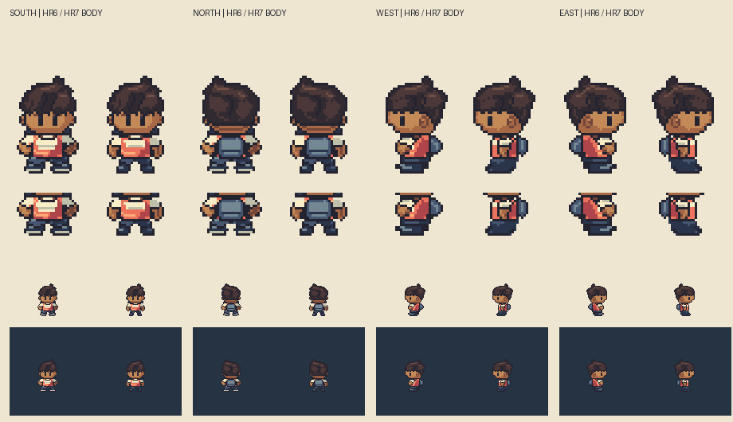
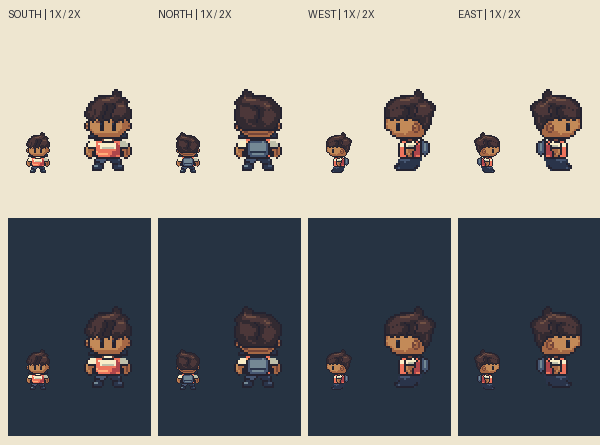
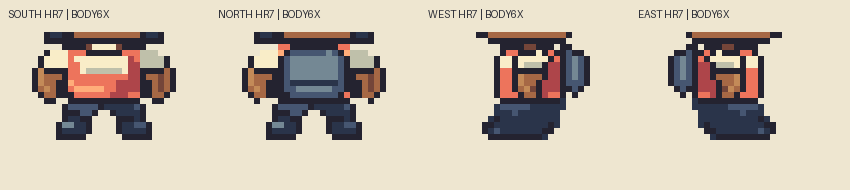

# M1.HR7 — Upright normal body and simplified shoes

**Body checkpoint implemented/checked; awaiting local/parent review.** Parent explicitly accepts HR6's rounded human **ears component only**. Whole normal body is not accepted. New authorization allows body changes below row46 while retaining every HR6 head pixel, Black child identity, no-mouth default, same starter outfit,32×64 canvas and `(16,64)` anchor. This is still the normal-base review; no body variants, feature swapping, customization UI, animation, gameplay replacement or TN4 release.

## Body changes and second-pass corrections

HR6's profile forearm folded forward across the abdomen, making the hand look like a held object. Torso taper and the hand projection reinforced a hunched read. Multiple bright sole rails and complete outlines between garment/shoe regions made thick stacked slabs; front feet appeared splayed.

HR7 draws short sleeves at the shoulder and lets the forearm/wrist/hand descend below them beside the torso. The hand lies under its sleeve rather than ahead of the abdomen. Shirt side contour is vertical through the chest/waist, with hips beneath it. Compact front/back shoes have straighter toes and quieter short accents. The original coral/cream inset shirt, blue shorts, dark sneakers and slate daypack remain the same starter design/material family.

First body pass is preserved in `iteration-a.png`/`body-detail-iteration-a.png`. Local review correctly identified two remaining ambiguities: a pale forward chest edge could read as a second dangling arm, and full internal outlines still banded the ankle. The second pass reduces the projected cream chest inset to a2×2 cloth patch, keeps the visible short sleeve distinct, merges internal short/shoe borders into one dark material mass and inks only the exterior toe/sole contour. All head pixels remain exact. Clean native and enlarged before/after and registered overlays were inspected again after this pass.

## Actual registered reference review

[Reference / HR7 / actual50% overlay, all directions](/Users/tanoshi/.codex/visualizations/2026/10/14/hero-hr7-reference/normal-body-reference-overlay.png).

[Actual HR6 versus HR7 overlays plus clean HR7](/Users/tanoshi/.codex/visualizations/2026/10/14/hero-hr7-reference/body-overlay-before-after.png).

Reference: `pret/pokeemerald` revision `5eff78649e7170a877b961ef0b3da13b81a16038`, Brendan walking.png, hash `f33ec07a5fd17f4422455f8bc55cd3d3522fa65c3bf740ecbdc00da705eaa0d1`, verified from the actual indexed PNG. Front/back/west frames0/1/2; east reference is explicitly mirrored west. Source16×32 doubled exactly to32×64; full frames share anchor with **zero independent translations**. Numeric overlay match is not artistic acceptance. Reference artwork and composites remain outside repository/build. This is source/asset inspection, not emulator observation.

## Four-direction critique / visible landmarks

| View | Shoulder / sleeve-elbow region | Hip / knee | Sole / silhouette critique |
| --- | --- | --- | --- |
|South|Balanced short cream sleeves; separate forearms descend toward hips rather than flaring outward. Collar and cream chest panel keep starter design.|Blue waist/shorts at54–58; no separately visible knee. Proposed construction guide, not reference bone measurement.|Straighter compact toe masses, dark sneakers without light rails; stance remains bilateral. Dark feet lose some contrast against the dark test backdrop; judge on native field colors before accepting.|
|North|Same body silhouette/arm attachment; slate daypack replaces front chest details and stays centered.|Same waist and foot registration; knee occluded by shorts/foot grouping.|Back foot shape matches front stance; no accidental front-facing cream chest panel on the back. Bag still occupies much of the short torso, a retained costume choice for reviewer judgment.|
|West|Sleeve at46–50, forearm below at51–54, hand toward55; one connected descending side arm. Projected cream front inset now only2×2 and does not continue down the chest.|Hip under vertical shirt side; knee hidden, no invented measured joint. Drawing guides keep shoulder/arm/hip vertically related.|Simple dark leg/shoe mass with only exterior contact contour. **At native size, shorts and sneakers still merge into a broad low-contrast dark mass.** This is the explicit tradeoff of removing rails, not a claim that feet are solved by fewer colors/bounds. Further separation, if requested after review, should use restrained material planes rather than restoring horizontal outline rails. Read is more upright and less like holding an object. Side torso remains intentionally compact within16px total body height; reviewer must judge whether its original garment silhouette is convincing, not just its vertical metrics.|
|East|Reflected body scaffold with retained head lighting. Same connected sleeve and lowered hand; no pale second-arm column.|Same proposed hip/knee treatment and full-frame registration.|Same quieter shoe mass and upright stance; no pose-specific drift of the preserved head or ground anchor.|

`body-landmarks.proposed.json` records actual visible region bounds plus proposed original drawing guides for shoulder, sleeve/forearm transition, elbow, hip and sole. **Knee is explicitly not separately visible.** These are clothing/pose annotations, not recovered hidden anatomy or exact source bone positions. Shoulder guide46, sleeve seam50, hip54 and sole edge62 are target-frame guides; the final painted foot row is61. See [visible guide plate](visible-landmark-guides.png) and [full countable profile grid](hero-grid.png).

## Saved-pixel checks and scope

All4 saved PNGs match indexed sources exactly, contain binary alpha/at most15 opaque colors, form connected silhouettes and retain the blank bottom rows. Every pixel at rows0–45 is exact HR6, including accepted ears, hair, face, eyes and empty nose/mouth construction. Body edits are confined to rows46–61:155 pixels/front,125/back,139/west,139/east. The actual Sprite Editor validator accepts the four-frame project and emits exact RLE.

Second-pass saved checks verify sleeve/arm masks overlap, hand bounds sit under sleeve, the projected forward cream strip does not run below50, light sole rails are absent, and internal ankle rows lack full-width dark rails. These support the named corrections; they do not certify connected anatomical reading on their own. Actual native/2× light/dark,3×/6× body, full silhouette and external before/after/reference plates were visually inspected. Head/ears remain untouched; no redraw of an accepted component is hidden in this body pass.

Sources: `art/source/hero-redesign-r7/hero-boy.sprite.json`, exact `hero-boy.rle.json`, separate `masks.json`, `body-landmarks.proposed.json` and explicit target-grid `build.py`. `verify.py` checks saved exports; `review.py EXTERNAL_FOLDER` performs preservation/body checks and produces review/reference plates. Python/Pillow required; external folder must stay outside the repo and contain the pinned `walking.png`.

No runtime tests required for static review-only art. No actual game/save/editor assets changed. HR6 Library identities remain historical; any stable HR7 export must have its own checkpoint identity. Owner has not exported HR7 to Library. TN4 hold remains intact. Exact next action: local/parent whole-body review before further revisions or fat/skinny/swappable features; no appearance or movement acceptance inferred.

## Local relay delivery

The stable corrected checkpoint is saved in Library, all version0: [body before/after](https://chatgpt.com/api/library/files/libfile_ca68b18a4fd88191ae83ab97cc5d1cdb/download), [four directions](https://chatgpt.com/api/library/files/libfile_e5b89a178b08819192880692f40e6b85/download), [native light/dark](https://chatgpt.com/api/library/files/libfile_c11693a5eb14819182e5a39c9968b7d1/download), [registered reference overlay](https://chatgpt.com/api/library/files/libfile_5b59182fa7708191aca39fb7f011a35e/download). [Identity/byte/critique receipt](library-review-receipt.json). The local coordinator inspected these actual PNGs and raised the pale chest-edge/internal shoe-rail issues addressed in the second pass. The low-contrast profile lower-body mass remains explicitly open for parent judgment. No whole-body acceptance inferred; later stages, gameplay replacement, deployment and TN4 remain held.
