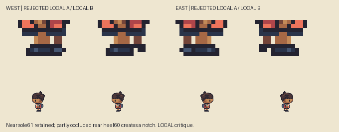
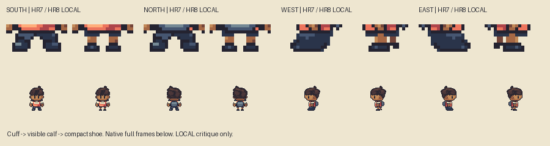
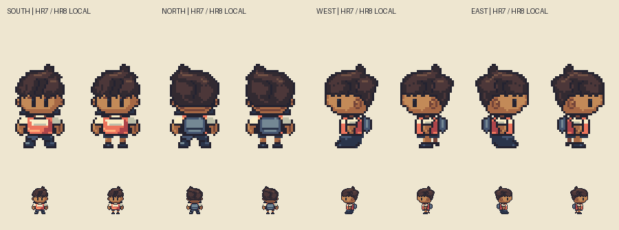

# M1.HR8 — Local lower-body construction trial

**Local B passed the narrow continuous-sole defect check; ready for parent trial, not a full checkpoint or accepted feet.** Parent rejects HR7's feet/leg mass: profiles read as an elongated merged boot, front/back still appear wide/splayed. Upright arm direction is improved and retained. HR6 ears component remains accepted; whole normal body is not accepted. This task changes only lower garment/leg/shoe pixels from row54 down, keeping HR7 rows0–53 exact, same original outfit, skin palette,32×64 canvas and `(16,64)` anchor. No mouth by default.

[Current true1×/2× light/dark](native-light-dark-local.png). [Actual registered source comparison, outside repo/build](/Users/tanoshi/.codex/visualizations/2026/10/14/hero-hr8-reference/lower-body-reference-local.png).

## Construction and local critique history

HR7's defect was not proven by aggregate width: the source's occupied row envelopes include multiple visible costume/foot parts, while the original costume differs. It was a silhouette/cluster read. HR8 separates the original blue shorts' cuff, a short visible lower-leg strip and compact shoe blocks beneath them. Front/back leg columns sit closer beneath hips, with small straight shoes rather than outward wedges. The visible skin is an original short-clothes construction proposal; source color bands are not inferred hidden knees/bones.

LocalA fixed the boot-to-shorts merge, but parent/local inspection rejected its **joined flat near/far sole**. That trial is retained in `local-a/`, not accepted. LocalB keeps the foreground shoe's row61 contact and gives the partly occluded rear heel a one-row contour step: the rear visible fragment ends at60, leaving a notch at60–61. The two shoes still overlap at their upper contact and each meets its own calf. The far visible fragment is subordinate behind the near shoe; its small visible bounds are **not** a claim about the full hidden foot's anatomy. The full sprite/ground anchor never moves. Front/back pixels remain exact LocalA; only the two profile rear-shoe fragments change between A and B.

## Explicit criticism and limits

- The leg-to-shoe transition is clearer than HR7's single dark boot mass; compact near shoe sits below its own leg, with less apparent forward projection.
- LocalB removes the common full-width low sole row that caused the second merged-boot read. Its rear heel is now a small higher fragment. **Parent/local review must still judge whether the occlusion looks like a plausible rear shoe, rather than two pads or a detached tick.** A notch/pixel test cannot settle that visual question.
- Front/back feet are small at native scale and use only a sparse interior accent. Review whether the new block proportions are suitably grounded rather than over-compressed; no blanket width score or “feet solved” claim.
- Short visible skin columns deliberately clarify this character's blue shorts. Knee positions remain unmeasured/hidden, not new source facts. The original outfit design remains unchanged.
- Dark footwear still loses contrast on the dark background. No bright sole rail is reintroduced to compensate.

## Evidence and bounded checks

Pinned reference: `pret/pokeemerald` `5eff78649e7170a877b961ef0b3da13b81a16038`, Brendan walking.png, SHA256 `f33ec07a5fd17f4422455f8bc55cd3d3522fa65c3bf740ecbdc00da705eaa0d1`. Actual indexed PNG is read/hash-verified; frames0/1/2 plus mirrored east, exactly doubled16×32 to32×64. Full frames share fixed anchor and no per-sprite translations. Both lower-body crops and full figures show reference/HR7/HR8. Source-only inspection, not emulator observation. Reference pixels remain external.

Current saved checks: exact rows0–53 preservation in all views; every actual change lies54–61 (front/back actual55–61, profiles56–61). Head/hair/accepted ears/empty nose-mouth and upper torso/arms are untouched. Saved indexed-source/PNG equality, at most14 used opaque colors in each current sprite, binary alpha, connected silhouettes, paired front/back anatomy, visible eyes and empty bottom rows pass. Both profile calf strips have a small visible gap at57–58. Shoe masks partly overlap, each touches its own visible calf, near contact stays61, rear visible heel ends60 and low contour gap remains. These support bounded preservation and named shape edits, not artistic acceptance.

`build.py` draws original target-grid pixels; `verify.py` independently reads the saved indexed source/PNGs. `local-review.py EXTERNAL_REFERENCE_FOLDER` creates concise plates and checks protected upper body, actual leg/shoe contact/occlusion and source hash. The external folder must stay outside the project and contain pinned `walking.png`. Python/Pillow required. This is the requested small local trial, not the full HR8 checkpoint/Library delivery. Native exports and editable source remain review-only.

Local critique of the actual second plate and native light/dark finds the continuous flat sole broken and near shoe readable as a compact separate block. This is a named local defect check, not feet/body acceptance. The stable current HR7-vs-HR8 and reference plates all show LocalB. Exact next action: local relay returns this concise trial for parent judgment. No full normal-base checkpoint, variants/swaps/UI or further production before that response. No gameplay replacement, deployment or TN4 release.
