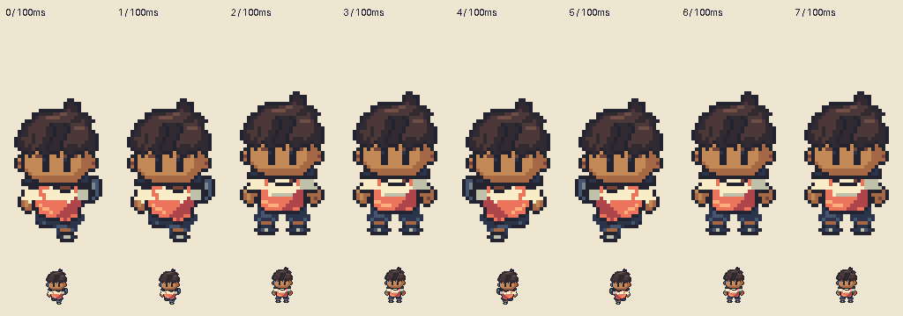
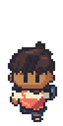

# M1.HR9 — Forward-only idle/walk candidate from confirmed user animation

**Analysis and original candidate implemented/checked; targeted local shoe critique completed, awaiting parent review.** Phil rejects HR8 proportions/motion interpretation. The exact eight-frame user GIF is now primary for this forward-only trial. Ears acceptance remains component-only; no whole-body/walk approval inferred.

Read [actual all-frame source observations](REFERENCE_OBSERVATIONS.md) first. This task does not use the static Library PNG, unconfirmed older still or stock pinned ROM sheet as substitutes for the supplied animation.

## Review artifacts

- [Source versus Hero ALL8 frames, native and exact3×](</Users/tanoshi/.codex/visualizations/2026/10/15/brendan-user-reference-original/source-hero-all-eight-contact.png>).
- [Synchronized native logical-grid comparison GIF](</Users/tanoshi/.codex/visualizations/2026/10/15/brendan-user-reference-original/source-hero-native.gif>).
- [Exact nearest4× animated comparison](</Users/tanoshi/.codex/visualizations/2026/10/15/brendan-user-reference-original/source-hero-4x.gif>).

All reference/comparison pixels remain outside the repository/build. Both characters have the same declared32×64 registration, full frames and phase timing; no independent fitting. Native means one target logical pixel, recovered from the source's verified4-display-pixel blocks, not a claim about artist workflow.

[Original native walk GIF](hero-forward-walk-native.gif) · [Proposed idle native PNG](idle-forward.png).

## Original construction and motion

Retains Black child identity, original swept hair, rounded human ears, skin ramp, coral/cream shirt, blue shorts, slate daypack and dark sneakers. Default mouth/nose remain absent. The head/ear drawing is **not reshaped**. Every occupied HR6 head pixel is preserved with a rigid Y translation: P is−2, A/C0. That aligns visible eyes to the confirmed source under the chosen14-top registration. Idle head is exactly HR6 at0. There is no per-frame skull scaling, independently moved eye/ear or inferred bone stretch.

Arms/clothing are compact and higher than HR8. A/C use opposite foreground-arm and lower-foot clusters with the rear foot partly hidden, rather than standing on exposed calf columns. The blue daypack edge adapts the source's high side-costume activity; it is not a claim that a particular source green/red shape is a bare raised hand. Shirt inset/hem and waist turn slightly with the step; head stays forward. Passing P has balanced two-foot clusters; A/C have a compact lower/forward foot with a smaller upper/overlapped rear cluster. Original shoe material is navy, with small local sole/toe accents rather than copied source red/green shoe styling.

The first shoe-accent draft is preserved in `iteration-a-shoe-accents.png`. Local inspection flagged tiny stacked bands. The revised P/idle shoes keep only short local accents and omit the full dark top border where shoe meets ankle; leading shoes shorten their accent too. Exact same-scale all8/native comparison was inspected after this change. No additional directions, body variants, swapping, UI or game assets are authored.

## Idle and timing limits

**No idle is observed in this source.** The provided idle is an original balanced P-derived rest pose, at the usual authored rest height2px below the walk P. Its head remains exact HR6 and its foot ends at61. It is separately labelled/provided, not inserted as a ninth source walk frame or called a measured idle.

The supplied loop is A,A,P,P,C,C,P,P at8×100ms. The candidate preserves8 physical GIF frames, including identical pairs, and800ms loop0. GIF playback matches that actual observed timing. Sprite Editor frame holds are6 engine ticks, approximately100.456ms; that editable hold is a small approximation, documented in metadata. Review GIF uses the verified100ms centisecond delays. No simulation clock or gameplay movement speed is changed; this is not a claim about ROM/emulator traversal timing.

## Critique for local/parent inspection

- Arm reach is now derived from the compact changing costume/skin clusters rather than HR8's long lowered forearm. Source costume differs, so the exact sleeve/hand interpretation remains an original adaptation to judge at native size.
- A/C's partly occluded rear leg and small lower foot follow the demonstrated overlap grammar. Without a source ground plane, the precise planted/lifted interpretation remains uncertain; review cadence/contact rather than asserting recovered bone lengths.
- The original hair crest does not flex like the reference cap tip. Only main face/eye2px motion is matched. That is intentional head/identity preservation, not hidden per-frame fitting.
- The daypack edge shifts visible side as the torso turns. This preserves original costume identity, but reviewer should judge whether the side reveal feels connected rather than popping.
- Navy shoes have local muted sole accents; judge whether they remain compact and readable without stacked tiers. No acceptance is inferred from a short stripe or bounding-box check.
- Local review still finds the original cream/coral torso and outlined blue hem/cuffs more graphic/heavier than the source costume. Exact foot weight and arm swing remain for parent judgment; no new revision is auto-started.
- The proposed idle lacks a direct source idle counterpart. It requires its own review and should not become the basis for other directions/variants automatically.

## Actual verification and editable delivery

Independent saved-source/PNG comparison passes for8 walk frames and idle. Every opaque head pixel is exactly HR6 under the documented rigid translation; eyes land on the observed source bands; nose/mouth masks stay empty. Source and candidate each have3 unique poses in the same duplicated8-frame order. All candidate poses are connected, binary-alpha and at most15 opaque colors. Proposed idle arm/leg/shoe anatomy pairs mirror; lighting/hair are not forced RGB symmetry.

All **four** GIFs—original native/4×, comparison native/4×—are independently decoded and match saved source PNG/composite pixels exactly in every frame, each has8 frames,100ms per frame,800ms loop0. Exact nearest enlargement is pixel-verified, palettes are lossless and original comparison source crops are exact. The actual Sprite Editor validator accepts both editable projects and emits exact RLE. These establish usable/timed artifacts, **not walk or art acceptance**. All8 source/candidate frame contacts inspected.

Sources in `art/source/hero-forward-r9/`: separate `hero-forward-idle.sprite.json` / `hero-forward-walk.sprite.json`, exact RLE, masks and explicit target-grid `build.py`. `analyze-reference.py EXTERNAL_FOLDER` records actual decoded observations and fixed registration; `prepare-review.py EXTERNAL_FOLDER` prepares contacts/GIF jobs; actual model `gifBytes` exports exact palettes; `verify.py EXTERNAL_FOLDER` performs independent checks. External folder must stay outside repo and contain the exact supplied GIF. Head source is original HR6; production authoring code reads no reference raster/mask.

No gameplay/browser-storage tests needed for review-only art. No other directions, variants/customization, live integration/deployment or TN4 release. Stable comparison paths are for local critique, then parent review; local relay handles any Library delivery with a fresh identity. Owner has not uploaded to Library. The local relay exported source/all-frame contact, native comparison GIF,4× comparison GIF and the explicitly proposed idle PNG with new Library version0 identities. [Coordinator receipt](library-review-receipt.json), [download animation verification](library-animation-verification.json) and [owner byte/frame recheck](owner-library-recheck.json) confirm both downloaded GIFs are byte-exact, retain8×100ms/800ms and exact nearest4× frames. The older flattened-attachment issue does not affect these confirmed GIF downloads. Exact next action: inspect the actual synchronized all-frame candidate before requesting further art, other directions or normal-base/walk acceptance.
