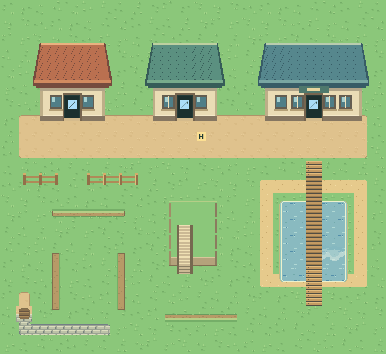

# M1.ME3 — Map Studio building, entrance and autotiling repair

Implemented, tested, pushed and published as owner-private version46. New environment art awaits the user's visual feedback. User rejects current buildings/ledges and requests Gen 3 research, doorway traversal, toolbox search and correction of bad automatic joins. Work stays on main. This is one editor repair deliverable; no new adventure roster or accepted world area is added.

[Phone editor](https://critz-tycoon.freemarketwildlife.chatgpt.site/map-editor/) · [Playable visual review](https://critz-tycoon.freemarketwildlife.chatgpt.site/map-editor/?review=me3). The review sandbox never reads or overwrites the saved map draft. The normal editor keeps v1 draft/export format and save keys. Copy for chat or critz-world.json communicates the whole layout and notes; a screenshot alone cannot preserve collision and links.

## Result

- Search the whole toolbox: terrain, features, stamps and raw tiles. Semantic aliases include house/door, steps/stairs, jump/ledge and freshwater/ocean depth. Search can show categories together, respects the raw sheet filter, supports multiple words and explains empty results. The new native building modules carry readable roof/wall/doorway search labels.
- Original modular cottage, garden house and shop revision uses explicit B contact compilation. Original playable master PNG/IDs remain unchanged. New art is labeled review in the editor and metadata; accepted adventure facades are not silently replaced.
- Select Passage and tap a house. Create room & return exit builds an editable interior, north entrance and south return link in one action. It rejects obstructed approaches, duplicate portals and full projects. Hero completes its entry step before travel. Sideways movement into the building aperture is blocked; adjacent walls remain solid. Doors have original closed/part-open/open presentation during approach; this is a simplified Critz sequence, not a claim of full Emerald warp timing or fades.
- Moving a house updates both its entrance and return landing; erasing it removes associated links while retaining the editable room. Validation reports unlinked doors, obstructed approaches, missing return routes, fences over roads, unsuitable stairs and blocked ledge landings. Stairs cannot grant walking across deep water.
- Ordinary test movement now imports the game's src/movement.js, including rest-turn, committed walking steps, pose/stride and released blocked behavior. The editor retains its separate directed-ledge animation and disposable boulder/project semantics; these are declared Critz choices, not full emulation.
- Ledge pieces connect only along the matching tangent/direction, with explicit ends. Registered fence pieces connect on both axes without per-piece vertical reanchoring. Cliff faces have context-dependent caps, faces and diagonal returns. The art direction and native specifications live in ART_BIBLE.
- Sand is a distinct surface for ground joins; the new bank adds its missing sand/grass and constructed-ground/sand contexts. A three-material corner gives adjacent ground priority over a conflicting diagonal. Sand no longer bypasses raw tiles or features; cache keys retain surface identity. Bridges render their transparent deck above water, with vertical orientation from their neighbors. Exact raw overrides suppress automatic water beneath them.

## Reference evidence

Inspected the pinned pret/pokeemerald source at 5eff78649e7170a877b961ef0b3da13b81a16038 using current online source access. [field_camera.c](https://github.com/pret/pokeemerald/blob/5eff78649e7170a877b961ef0b3da13b81a16038/src/field_camera.c#L225-L243) selects stored metatile references and layer types; it does not discover neighbors to generate artwork. [field_door.c](https://github.com/pret/pokeemerald/blob/5eff78649e7170a877b961ef0b3da13b81a16038/src/field_door.c#L135-L150) stores door animation imagery/tables. [field_screen_effect.c](https://github.com/pret/pokeemerald/blob/5eff78649e7170a877b961ef0b3da13b81a16038/src/field_screen_effect.c#L677-L727) orders opening, walking and warp/load. [field_player_avatar.c](https://github.com/pret/pokeemerald/blob/5eff78649e7170a877b961ef0b3da13b81a16038/src/field_player_avatar.c#L643-L695) distinguishes directional ledge jumps from ordinary collision. Previous pinned building measurements remain in REFERENCE_MEASUREMENTS and EMERALD_ENVIRONMENT_RESEARCH. Source inspection is not an emulator capture; no ROM or reference-game art is shipped. Original Critz colors, sprites and editor adjacency rules are design decisions for review.

## Checks and limits

224 unit checks pass. The revised surface recipe resolves native IDs across every neighbor mask and material pair; semantic tests exercise the door roundtrip, relocation/deletion, invalid configurations and ledge connectivity. Independent native check passes505 assertions over357 source images, binary alpha, connected ledge/fence edges, doorway aperture/threshold and byte-identical original master. Build passes. 69 final dist browser checks pass:22 editor,8 revision/search/door,9 game integration and30 adventure entrance checks. Phone/native screenshots inspected; browser report JSONs are retained here. [Deployment receipt](deployment.json) and [archive proof](archive-check.json) verify the source, unchanged tested runtime and successful publication; only synthetic storage is used. Physical Safari/haptics remain unverified.

This is not a claim of universal autotile correctness or a complete asset catalogue. Automatic project-to-adventure compilation, selected adventure Hero in standalone authoring, full oriented/elevation-aware stair authoring, authored bridge junctions, and the complete NPC/animal/animation catalogue remain separate work. Tree art is unchanged and the user's negative feedback remains unresolved. Map check does not prove every path reachable from spawn. The editor review must be judged visually by the user before the revised bank is promoted to accepted adventure maps.

Exact next action after publication: user walks the review, inspects building roof/wall/door contact, all ledge directions and mixed ground joins, and reports approval or concrete refinements. Then continue the remaining catalogue/compiler and tree/stair work. No visual gate is self-approved.

## Publication receipt

Source9dd5f6e3dd1182991110021ff08780f0895c8e23 matches verified origin/main and Sites source. Owner-private version46 / appgdep_6acb185605008191ac3f3b0bf7f8a8b3 succeeded2026-10-10 at10:02:25pm Pacific. All1,334 runtime files match the tested build; all2,663 build files match the2,664-file archive with source hosting metadata the sole addition. No caches/resource forks. The deployed review reached Ready in the in-app browser with its draft-preservation notice and retained tab. A browser runner needed its existing runtime module path restored; a unit fixture spawn was moved out of the house it deliberately relocated; a palette preview's missing empty actor list was corrected before final release tests. Initial archive assertions were corrected to account for the helper's exact source hosting manifest before publication. No push or native publication failed. Final documentation receipt is pushed without changing the tested runtime. No visual acceptance is inferred.

