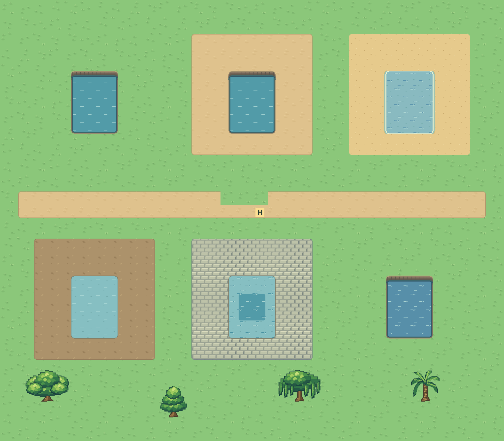

# M1.ME6 — Exact tiles, independent water bodies and useful map checks

Editor/water repair checkpoint under the user's explicit overnight implementation and push authorization. New appearance remains for morning feedback; no broader visual/feel gate is self-approved. Parent owns aggregate integration and Sites publication. This batch preserves the completed OV1 trees, transparent placement ghosts, footprint overlays, quiet soil, approved Hero, named story, money and save keys.

## Result

- Exact raw overrides suppress hidden feature traversal, feature art, neighboring fence/ledge joins and collision overlays. A walkable override over a ledge takes one ordinary step. Raw cells also paint above adjacent registered water projection. Objects retain their explicit blockers.
- Water depth treatment belongs to each eight-neighbor connected body. A separate shallow pond cannot alter an all-deep lake. Contact margins reuse actual path, soil, paving or sand pixels; nearest land context selects beach wash without wrapping map rows.
- Water fields compile inside padded component bounds and are reused when an unrelated dry cell changes. Cropping retains the original compositor and approved B registration. No new asset pixels, formats, collision cells or animation timings are introduced.
- Map check reuses the canonical mixed-depth shallow-border validator. It finds trapped starts and unreachable directional passages/edge links using actual movement, fence crossings and ledge hops, with pushing disabled. Each finding has a Show cell button that selects its map, centers the cell and exposes the coordinates. Reachability is explicitly from each map's own Hero start; this is not a claim about every possible adventure quest state.
- Resizing removes cropped entrances, cropped passage cells, paired return links and arrivals outside the new bounds. Editable rooms and unrelated links survive; Undo restores the whole project. Removing or retargeting an auto-paired passage also removes its old paired return.

The review route is `/map-editor/?review=me6`. It shows six separate water bodies on existing materials, a properly enclosed mixed-depth pond, exact overrides and all four unchanged native tree styles. Like other review routes, it never reads or saves over the user's draft.

## Actual verification

259 unit tests pass, including eleven new semantic/geometry checks. Six bounded-field examples cover separated pools, map edges, diagonal contact and islands; assembled wet masks, banks and four wash phases equal the original full-map field pixel-for-pixel. Standard checks plus ten owned/relevant module syntax checks pass. Build verifies all30 canonical MIDI assets.

86 isolated release-browser scenarios pass:12 new repair checks,22 editor,8 revision3,17 revision4,8 fences,9 adventure integration and10 preserved overnight-art checks. The new pixel probes verify twelve raw composites, four material contact margins, zero changes to an unrelated deep pool and an exact override beneath registered water projection. Eight existing independent tree depth composites still agree. No browser exceptions or missing assets. Native and320/390px phone views were inspected; phone screenshots use fresh navigation and viewport capture. All storage is synthetic; physical Safari/haptics are untested.

Same-device Chromium benchmark against immutable baseline `f0a6b31a39a58b752e365ab921da4f14e2d18a87`:60×40 cells, one10×10 pond,480×320 bounded render, three fresh-map samples. Median cold render falls from **1,760.0ms to123.8ms (14.2×)**. A distant dry edit falls from **1,770.6ms to0.7ms**, with zero components rebuilt. Field area falls from2,519,040 to159,744 native pixels. These are local Mac measurements, not physical phone timings; cached/distant-edit submillisecond ratios should not be generalized. One very large connected lake can still require a large synchronous compilation.

[Focused browser evidence](browser-checks.json) · [Retained regression evidence](regression-checks.json) · [Unit results](unit-checks.json) · [Exact tested runtime hashes](runtime-checks.json).

## Handoff and remaining gaps

No Sites publication is performed by this worker; parent coordinates the combined release. Until successful publication, the existing phone URL serves the earlier hosted build. Do not infer deployment from a GitHub push. Exact commit/push receipts are recorded in PROJECT_STATUS and the checkpoint receipt.

Next: parent integrates the independent UI/art slice, runs aggregate checks and publishes the exact tested combined build, then the user reviews the phone editor. Further editor work remains: full semantic aquarium/terrarium/NPC/animal catalogue, project-to-adventure compilation, footprint-aware overlapping prop placement, selection/copy/paste/eyedropper, oriented stairs and bridge junctions, selected Hero and shared flower/grass animation. No claim of universal editor readiness.

