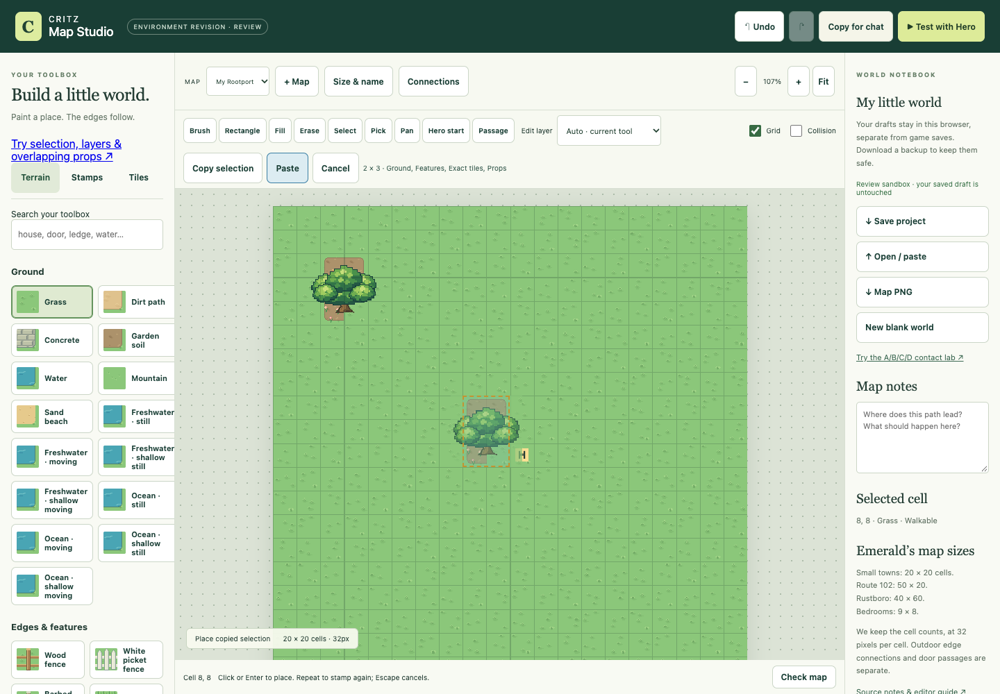
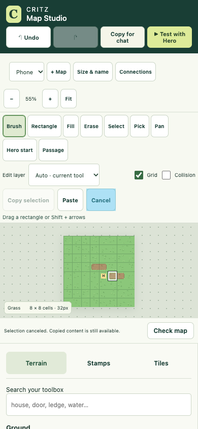

# M1.ME7 — Practical selection, layers and footprint-aware authoring

Implemented under the user's explicit overnight authoring-productivity assignment. Scope is Map Studio plus dedicated tests/docs. Existing native images, adventure/home/tank code, accepted maps, story, game save keys and v1 project fields are unchanged by this worker. Parent owns combined integration and publication; no deployment is performed here.

## Authoring workflow

- **Select:** drag an inclusive rectangle, or focus the map and extend with Shift+arrows. Copy selection or Ctrl/Cmd+C copies the selected edit layer. Auto copies Ground, Features, Exact tiles and Props. Copy does not mutate the map or history.
- **Paste:** click Paste or Ctrl/Cmd+V while the map is focused. A translucent native preview and dashed rectangle show placement. Click or Enter commits one whole operation; repeat to stamp again. Escape/Cancel leaves the map intact and retains the reusable clipboard. Copies live in this editor session, independently of system clipboard and saved maps.
- **Layers:** Auto preserves the previous terrain-restoration/Erase workflow. Ground, Features, Exact tiles and Props can be painted, copied or erased independently. Ground-only edits retain features and raw collision. Props-only erase targets occupied cells; pointer jitter cannot erase a second object underneath the same cell.
- **Pick:** use Pick or I with map focus. Auto prioritizes occupied prop footprints, then other sprite bounds, exact tiles, features and ground. Choose a layer to sample it specifically. Picking exact tiles retains their saved collision choice; picking creates no undo entry.

Placement checks actual occupied ground independently of overhead projection. Trees and benches can share artwork space without sharing solid cells. Picking prefers ground footprints, then sprite bounds/depth. Legacy stamp coordinates and IDs stay intact; artwork can project beyond the map when its ground footprint fits. V1 import accepts these valid overlaps without a save migration.

Copies include whole selected prop footprints and their full native overhang. A partial prop selection explains how to include its footprint or copy another layer. Original props retain their IDs; pasted props receive distinct IDs on every successful repeat. Existing passages, returns, edge links and Hero start are never duplicated or moved by copy/paste. Copied buildings need their own Passage links. Pastes that block an existing passage, arrival or door approach fail atomically, as do overlaps, bounds and the existing4096-prop limit. Moving a building retains its ID and relocates its paired entry/return coordinates.

Successful pastes/moves/strokes are one undo action. Failed and no-op operations retain redo. Escape, pointer cancellation, focus loss and hidden-page interruption discard incomplete strokes; autosave never writes a live preview. Clipboard/selection remain separate from persisted project content.

Playtest now clamps its camera like the existing adventure and centers small rooms. Flowers reuse the existing source cadence/frames; contacted grass reuses existing base/front planes and controller action ticks. No asset rescaling, new native pixels or movement changes.

Review route: `/map-editor/?review=me7`. It reuses the existing Grove sandbox with a bench behind a canopy; this is an isolated authoring review, not an added adventure location. It never reads or replaces the saved draft. New tool presentation remains for morning feedback.

## Verification and handoff

Fourteen dedicated model regressions cover overlap/picking, v1 roundtrip, overhang at map edges, partial footprints, copied layers, bounds/overlap rollback, repeat IDs, preserved passages, moved door links, eyedropper, camera, the v1 prop limit and footprint-only erase. The full current-checkout unit result is recorded in [unit evidence](unit-checks.json); it includes the concurrent art worker's tests.

107 isolated release-browser scenarios pass:21 new productivity workflows plus86 existing editor/building/fence/water/adventure/preserved-art regressions. Real touch events select, copy, paste and cancel on390px; controls retain44px heights and no320/390px horizontal overflow. Text fields/open dialogs keep editor shortcuts out of map actions. Native overlap and grass-front composites match independent draw order pixel-for-pixel; flowers/grass animate using existing frames. Synthetic normal-editor storage proves incomplete/canceled strokes never persist. Review sentinels stay byte-identical; no missing assets or browser exceptions. Native, paste-preview, desktop and phone views inspected. Physical Safari is untested.

The browser preview retains background/art runtime from `137c7537e787f74eb19d4e077ddfa22130f50569` and overlays only this worker's six editor runtime files. This isolates the other worker's unfinished adventure/home/tank files. [Focused evidence](browser-checks.json) · [Retained regressions](regression-checks.json) · [Exact tested runtime hashes](runtime-checks.json). Parent still needs aggregate checks on the combined final checkout before publishing.

Further work remains: semantic aquarium/terrarium/NPC/animal catalogue, adventure compiler, oriented stairs and bridge junctions, selected Hero, and broader animation authoring. No claim of universal readiness or visual/feel approval.

