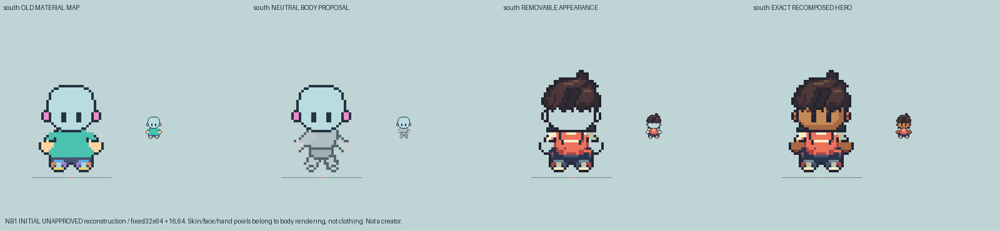
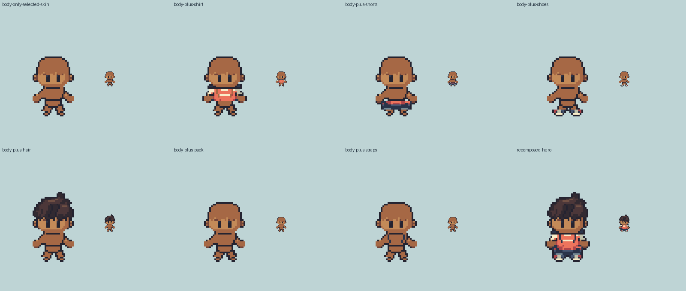

# M1.NB1 — First South neutral body checkpoint

**Foundation reopened; SOUTH IDLE only, UNAPPROVED.** No creator/UI, other directions/walk packaging, Girl views, roster, runtime/save/deployment or Library change. Selected dressed Hero and Girl files remain byte-exact.

## Audit and actual construction

HR14's material dummy is a recolor of the clothed body's occupied pixels: `hero-directional-r14/build.py` iterates every body pixel, applies lower-costume material colors and otherwise teal. It has a bald head but no independent underlying torso/pelvis/limb/foot shapes. Its prior bald/material pass never established anatomical-body acceptance. The old R12 segmented scaffold is not transplanted; its old neck/feet/joint values are not measured anatomy.

NB1 draws independent non-detailed mannequin head, torso, pelvis, two arms/hands, two legs/feet as actual RGBA layers. [Each exploded actual layer](front-idle-exploded-body-layers.png) has a corresponding stored cell mask in construction.json. Head overlaps the upper torso; no exposed long neck or extra vertical leg length. Frame32×64 and edge anchor16,64 remain fixed; body contact row61 matches this existing selected pose. Torso/limb mass is broadened from the first skeletal trial. Each compact rounded foot has8 cells; its leg overlaps4 cells left and2 right. Hidden contours and segment connections are **authored reconstruction**, not source-measured bones or accepted body standards.

## Real body contribution and removable clothes

The selected skin/face/ear/eye/hand rendering belongs to the body, not the clothing image. There are **167 actual visible body-contribution cells**; the costume owns none of those cells. Every selected visible body cell is supported by independently drawn neutral-body geometry. Skin rendering maps the body to the selected complexion and preserves visible source face/hand shading/features separately. It is a selected-identity appearance application, not a new feature-swap system.

Shirt, shorts, shoes, hair and straps have real independent RGBA/ownership masks. Front visible pack contribution is empty because it is occluded; the full original rear pack is stored separately with its role disclosed. Shorts/shoes and ambiguous head-edge ownership are authored region decisions, not hidden anatomical observations. Later poses and arbitrary garment swaps remain unproven.

The retained old `headMaskHero` includes dark jaw/collar/edge sites and is not anatomical truth. A rejected27-cell extension misclassified only dark/navy pixels as head surface; **zero were brown skin**. That extension is removed. Earlier non-skin head edges/fringe are removable hair; non-skin/non-eye sites43+ are garment/collar boundaries. The body-only view keeps its original smooth bald contour, with no added sideburn tabs or full-width collar band. The original selected Hero remains exact.

[Each actual body/costume contribution alone](south-idle-actual-body-costume-contributions.png). `south-idle/actual-visible-body-contribution.png` shows body-owned final cells; `removable-appearance.png` contains no face/hand skin. Compositing the body rendering plus separate visible costume layers reproduces selected Hero byte-for-byte in decoded RGBA. The inspectable dressing-coverage stencil currently clips **zero** body cells. It does not erase the body to hide mismatches.

## Checkpoint limits and review

Seven saved-construction checks cover visible-skin geometry support, two foot/leg overlaps, exact recomposition, contact row, disjoint clothing/body contribution and actual visible body ownership. The editable diagnostic validates in the actual Sprite Editor. [Protection evidence](protected-inputs.json) checks277 tracked Hero/Girl source/review files against unchanged source HEAD. [Current structural checks](checks.json).

Owner inspected the actual checkpoint, exploded layers, body-contribution and garment-removal plates. The mannequin proportions are **still a proposal**; head/body balance, rounded mass, arm/hand attachment and foot readability need independent visual judgment. No claim that it is an approved anatomical base or ready for creator swaps. Other directions/current walks and normal/slow packaging follow only after the first-body checkpoint response.

Failed first opaque-appearance and later dark-head-extension iterations are retained externally at `/Users/tanoshi/.codex/visualizations/2026/10/15/nb1-initial-experiments/` (`pre-review-scratch` and `rejected-dark-head-extension`, including source/PNG/mask evidence). They are not accepted assets. The first trial's extra directional diagnostics are scratch only; the deliverable is South idle.

Exact next action: independent first-South body contour, real ownership and garment-removal review; then bounded repairs or explicit continuation. No extensive packaging or broad expansion now.
