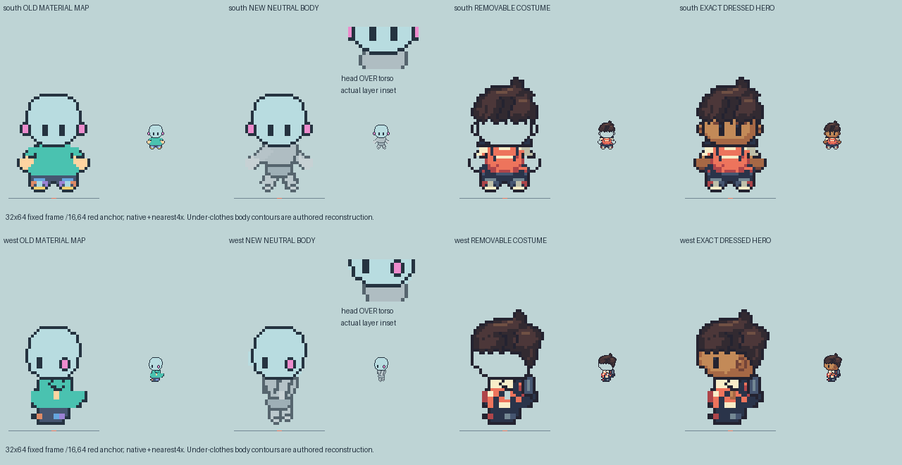

# M1.NB2 — Compact South/West body diagnostic

**Foundation OPEN; two existing idle views only.** Parent first authorized full existing-pose continuation, then prioritized a small front/profile construction diagnostic before extensive walk packaging. This checkpoint follows the newer priority. No creator, new Girl view, roster, runtime/save/deployment or Library operation.

## What is retained and proposed

The accepted NB1 South construction subcheck is retained: all32 prior South PNGs are byte-exact, including neutral SHA256 `92c68cd507ab6b1c9311360e6dd119cd2ce2d87945ed5f0c801b3a617aeba571`. That is a scoped construction result, not full anatomical-base approval.322 tracked selected Hero/Girl/prior NB1 files are unchanged.

West uses an independently drawn compact torso/pelvis and separate arms/hands/legs/feet; it does not copy the flared shirt, shorts, shoes or pack into the body outline. The upper torso begins at row42 under the head; near shoulder anchor is row43, occluded by the foreground head. Head/torso masks overlap46 actual cells (South32). There is no separate neck-post part or added neck length. [Actual isolated head/torso, arm/hand and leg/foot views](south-west-part-toggle-diagnostic.png).

The profile near arm is explicitly in front of the torso; the far arm is behind. Actual selected visible-hand sites attach to the near arm. Both foot layers overlap their own leg layers by at least2 cells. Bare feet are compact rounded4×3 authored footprints with8 occupied cells each, not copied shoe alpha; contact row61 and edge anchor16,64 are retained. Hidden contours and attachments remain **authored reconstruction**, not clothing-derived bone measurements or accepted anatomy. Torso mass and limb readability need independent visual judgment.

## Face, clothing and actual contribution

Ownership is audited per view. South uses its preserved actual eye cells/collar boundary; West uses its own8 eye-feature sites, actual selected skin ramp, profile hair/ear/face pixels and its own collar boundary. The old Hero-head mask is not treated as anatomical truth.

The West bald surface needs8 additional cells at actual brown visible face/nape sites `(5,36–40),(6,40),(23,43),(22,44)`; these are stored as explicit reconstructed visible-skin support. No dark/navy collar pixels are used to enlarge the bare head. Upper scalp remains the retained bald contour; hidden skull shape is not reference-measured.

South supplies167 visible body-owned cells; West144. Clothing contains none of those face/eye/ear/hand pixels. Both have **zero** dressing-clipped body cells. Saved body rendering plus removable garment/hair/pack/strap RGBA recomposes the selected Hero exactly. Actual body and costume masks match their saved RGBA, with explicit part z-order/visible-part ownership. Full original rear pack is stored separately; the compositing proof uses source-verified visible pack contribution. This is a selected-art layer proposal, not proof that arbitrary swaps work.

Separate body-only and body-plus-one-garment PNGs are in each view folder. The compact diagnostic shows the costume alone, exact selected Hero, and a zoomed actual head-over-torso inset. `construction.json` holds every actual ownership/part/coverage cell; [saved-layer checks](saved-layer-checks.json), [small diagnostic checks](small-diagnostic-checks.json), and two actual Sprite Editor validations pass. Tests do not approve the appearance.

## Pinned reference and scope limits

Reference-bearing adjacent comparison stays external: `/Users/tanoshi/.codex/visualizations/2026/10/15/nb2-small-diagnostic/pinned-reference-south-west.png`. It shows local pinned pret/pokeemerald revision `5eff78649e7170a877b961ef0b3da13b81a16038` ROM art0/2 at exact2×32×64, beside fixed-frame current neutral/costume/recomposed Hero. No per-sprite fitting. Reference is source-art observation, not emulator capture or a measurement of bones under clothes. It informs projected head/shoulder overlap and compact framing, not a claim that a cap is bare-skull anatomy.

Owner inspected the two compact plates and actual external reference comparison. **No full four-direction/walk foundation or motion pass is claimed.** Unreviewed earlier generated pose experiments are labeled scratch at `/Users/tanoshi/.codex/visualizations/2026/10/15/nb2-unreviewed-scratch/`, excluded from this deliverable. The complete pose/normal/slow packaging request remains pending after this small diagnostic review, not silently completed.

Exact next action: independent South/West body silhouette, projected head-over-shoulder read and actual limb/costume ownership critique, then bounded fixes or resumed existing-pose continuation. No creator or gameplay work before the full body-layer review.
