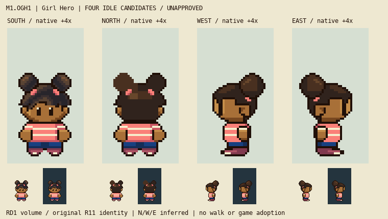

# M1.OGH1 — Girl Hero four-idle candidate

**Stable v2, awaiting root visual review. No appearance acceptance or walking authorization.** All writes are confined to `art/source/overnight-girl-r1/` and this review directory. No index, commit, push, runtime, saves, shared documentation/generator or deployment changes. Root coordinates source freeze and any later commit.

[Actual native lineup](four-idle-native.png) · [Countable 6× grid](four-idle-grid.png) · [v0→v1 bounded correction comparison](v0-v1-idle-corrections.png) · [Separate flat construction, painted character, hair and features](separate-construction-hair-features.png)

## Source and identity

The selected R11 generated concept and supplied design image were actually viewed, alongside original C6/GH1 native front PNGs. Retain ten-year-old Black player-named protagonist option, twin natural puffs/coral ties, short temple locks/fringe, coral/cream shirt, blue shorts and burgundy/cream shoes. No new personality or costume, no backpack, no default mouth/nose. GH1 history remains untouched. The generated concept is design intent only; no illustration resizing supplies native pixels.

Current construction anchor is RD1 at source `a25379df5c76fc1d4bf88c02525aef5affa4781c`. Its actual frame2 is passing, not an observed idle. South preserves all final RD1 alpha from row45 down and all GH1 head pixels through44. Outfit material placement is original; internal RD1 labels/crown/covered skull remain proposals pending Phil's manual correction. This adaptation does not certify body segmentation or narrower/taller anatomy for a girl.

Actually inspected primary local Brendan and Man1 nine-frame strips at pinned `731ad5bfd6e6f265508d0efcca0ba42f9dcf5881`, through native and integer6× boards. They show head occluding the shoulder, compact side garment/arm overlap, near hand at hip, rear face hidden and full shoe/near-far occlusion. Supplementary May idle index2 was actually viewed in `local-review/overnight-cast-qa/primary-idles-native-6x.png`, supplied by independent QA at pinned `5eff78649e7170a877b961ef0b3da13b81a16038`. These are source asset observations, not emulator captures. Exact TSR8329 pixels were unavailable; no unseen source claims. The supplied fan GIF proves front only. No reference pixels enter the candidate.

North rear hair, profile body/head/arm volume, covered skull, puff occlusion, far-foot completion and wardrobe turn are original proposals. In profile the far puff is occluded; the single visible round near puff is intentional. East mirrors the proposed symmetric profile construction, including current hair arrangement; physical asymmetric hair arrangement has not been established from source. No hidden anatomy or joints are measured here.

## Bounded v1 corrections

The first v0 board was rejected for the side lower-body read. Original v0 files and builder/source are retained in `history-v0/`; no history is overwritten.

- Replace the horizontal double-puff cap with one rounded visible near puff and explicitly occluded far puff. Retain original front identity exactly.
- Shorten West pale sole from11 cells across row60 to3 local cells x11–13. Retain full near-shoe original envelope, ten-cell contact at row61 x11–20, and toe/heel stepped curve. Remove four tiny exposed farshoe cells at rows57–58; do not shrink the entire foot. East reflects this construction.
- Shape the near arm into a rounded vertical cuff/palm mass beside the hip. The palm remains substantial, connected under the sleeve and independent of shirt stripe. No tiny hand or added exposed neck row.
- South/North each retain exact lower-body alpha. Change eight existing shoe material cells so pale row60 has two local2-cell accents instead of almost-white rails. The dark row61 contacts were already connected; they were never detached alpha.
- Replace the centered North flat highlight bar with a smaller connected upper-left hair plane. Front/back body silhouette remains shared RD1 volume. Color/appearance acceptance remains open.

[Saved per-direction exact RGBA changes, alpha runs and sole cells](revision-evidence.json) records current final pixels against v0; original v1 evidence remains in `history-v1/revision-evidence.json`. Native canvas32×64; frame-edge anchor(16,64); last opaque row61; rows62–63 empty. Painted contact is distinct from frame anchor.

## v2 profile puff correction and frozen owner review

Root's actual v1 review found the shoe improved but the upper hair still a long projecting wedge with a barely recognizable puff. Preserve v1 in `history-v1/`, including actual layers and builder. Current v2 gives the near puff a round13-row contour with its own one-pixel lower rim painted over the crown; the previous union-only silhouette erased that lower arc. The tie sits at the lower attachment. A compact curved crown plane replaces the long horizontal highlight band. Far puff remains occluded; this is an original projection proposal, not source-proven hair anatomy. Front/back are untouched. Every West/East face/skull, ears, eyes, shirt, arm, shorts and shoe layer is exact v1. Only actual hair/tie layers change, and all final changed pixels lie within rows21–34. No neck, face or lower-body adjustment disguises the hair change.

Writer actually inspected the final native lineup,4× light/dark board,6× grid and [3× v1→v2 comparison](v1-v2-profile-puff.png). The round near puff now separates visibly from the crown in both profiles. Remaining judgment is overall turn/projection and charm; root independently decides whether the stated blocker is resolved. **40 independent saved-file protection assertions pass**, in addition to20 builder checks and8 fresh editor validations. [Exact checks,153 changed final pixels per profile and final file hashes](v2-freeze-checks.json). South/North0 final changes fromv1; all protected per-view layers remain exact. Stable board SHA256: `27aa7538e7bfefe97bbfc9508b2337a5648d98968aaf35c1976f145454b8a51e`. No further writer changes until root's next concrete review.

## Editable deliverables and actual verification

Each direction has `idle.png`, actual transparent semantic PNG layers, and `flat-construction.png`. Source directory contains four `*.layers.json` files with ordered actual pixel arrays/palette, four reopenable `*.sprite.json` painted projects, and four separate flat-construction editor projects. Flat diagrams expose proposed construction independent of original hair/eye/ear layers; the full-body diagram is not a recovered nude child or an approved normal master. Painted layers recompose exactly; diagram and painted composite are different, clearly labeled artifacts.

Bundled Python/Pillow rebuilds with `art/source/overnight-girl-r1/build.py`. Source/PNG hashes and declared proposals live in `construction.json` there. [20 actual saved-pixel checks](checks.json) pass: exact serialized layer recomposition, binary alpha, fixed canvas/padding, connected silhouettes, four distinct facing PNGs, retained South identity and RD1 lower envelope. [Eight actual Sprite Editor `validateProject` calls](editor-validation.json) pass. No runtime tests are appropriate for these isolated PNG/source changes.

Writer actually viewed current native lineup, native/4× light/dark board,6× grid,3× before/after correction plate and3× saved-layer proof. Corrected profile puff/sole read improves over v0. Remaining judgment: profile shoe may still read long at native size; the side shirt is a short striped block under a large head, the rear hair is deliberately restrained, and the turn/occlusion proposal needs root's independent artistic judgment. Technical tests are not visual acceptance.

Exact next action: root inspects these stable v2 idle artifacts and supplies concrete corrections. **No walks until four-idle review is complete and root explicitly coordinates.** No automatic gameplay replacement, creator restart, upload or deployment. Existing phone game remains unchanged by this task.

Checkout verification at handoff: `main`, HEAD `967a6ad5aa6820cf268b47fc1deae47005600638`. Both assigned folders are untracked task outputs; root's explicit sole-writer coordination hold forbids independent staging/commit/push. This is not a verified remote source freeze. Unrelated pre-existing/other-owner changes remain present and untouched.
