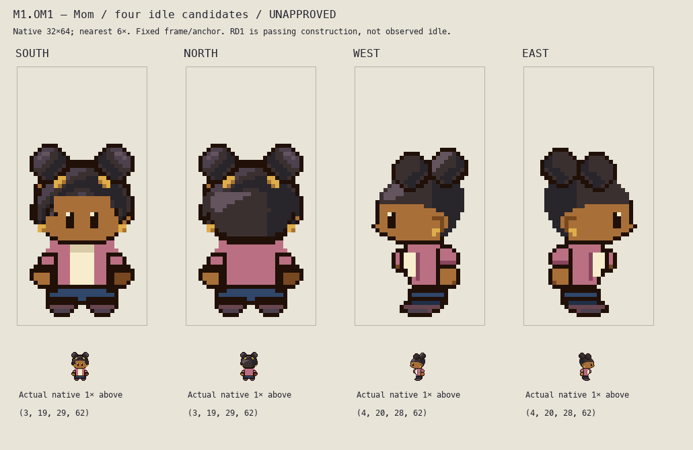

# M1.OM1 — Mom four-idle candidate checkpoint

**State: awaiting root visual review after one bounded correction. Unapproved art.**

The assigned scope is Hero's existing adult mother, four idle facings only. Existing appearance cues remain: Black adult woman, rounded swept natural hair with paired puffs, gold earrings, rose cardigan, cream top and navy trousers. No personal name, occupation, costume canon, story change, walking or gameplay replacement is added. Mom remains Hero's loving mother; medication needs are not villainy. The commissioned overnight candidates supersede the older sequential-roster hold only within this isolated assignment.

## Review files

- [Native full-frame lineup](idle-native.png), four32×64 frames at actual1×.
- [Corrected comparison](idle-comparison.png): full64-row frames at nearest6× plus actual1×.
- [Before/after](before-after.png): preserved v0 versus corrected idle candidate at nearest3× plus native.
- [Light/dark inspection](background-inspection.png): actual native and nearest4×.
- [Countable grid](idle-grid.png): one square per native pixel, x16 center, Y0 bottom,10-row guides.
- Individual `idle-south.png`, `idle-north.png`, `idle-west.png`, `idle-east.png`; transparent native32×64. Separate6× files have no smoothing.
- Editable source: [builder](../../../art/source/overnight-mom-r1/build.py), [combined sprite project](../../../art/source/overnight-mom-r1/mom-four-idles.sprite.json), per-direction `layers.json`, ten real RGBA layers and `idle.sprite.json` under `art/source/overnight-mom-r1/{south,north,west,east}/`.
- [Saved-file checks and visible-region measurements](../../../art/source/overnight-mom-r1/saved-file-checks.json), [frozen review hashes](../../../art/source/overnight-mom-r1/freeze-manifest.json), [protected input hashes](../../../art/source/overnight-mom-r1/input-hashes.json).

Appearance/head/hair/eyes, garment, arms, hands, legs and full shoes remain editable. Flat semantic part boundaries are provisional; none claims approved segmentation or recovered hidden anatomy. Palette materials have explicit names in the builder, and every layer JSON records actual cell colors. Mom has no backpack.

## Actual reference inspection and limits

Current front construction is RD1 `a25379df5c76fc1d4bf88c02525aef5affa4781c`: native32×64 original flat dummy from supplied fan GIF SHA`5fe7935d…6015e`, frame2, exact displayed block removal then translation(0,+16). That source is a **passing pose**, not an observed idle. RD1's rounded covered skull and internal regions are proposals; manual label corrections remain pending. OM1 uses RD1's projected visible front body scale, not an approved final master or immutable part map.

Actual original C6 Mom native PNG, sixfold enlargement, C2 design guide, C3 Mom guide and C7 full directional sheet were viewed. The C6 hair cells are retained as a separate original Critz appearance layer in South/North; the body is newly built from the declared current construction reference. Adult face/eyes are two rows above the child source, following the established C6 adaptation, not an Emerald skeletal measurement.

Actual primary Brendan/Man1 native and enlargement strip was inspected at `/tmp/ds1-primary-reference/primary-inspection.png`, pinned revision`731ad5bfd6e6f265508d0efcca0ba42f9dcf5881`. Actual primary Mom strip was subsequently viewed at `local-review/overnight-cast-qa/mom.png`, pinned`5eff78649e7170a877b961ef0b3da13b81a16038`, SHA256`a404a3c79252a6a13e10622307c3bce4c76c1e1a39814b7c7a11ad7520442289`. Index0 was explicitly transparent. Frames0South/1North/2West were viewed in the QA native/6× plate; actual West2 and side strides7/8 were inspected at10× in external `/tmp/mom-primary-side-inspection.png`. **Stride frames were inspected as reference, not authored as new Mom animation.** The initial external strip-alpha conversion was wrong and was corrected before any color/part judgment; actual palette pixels were then viewed with index0 transparency.

Primary Mom West shows compact head-over-shoulder overlap, a near arm beside the hip and compact shoe occupancy; her source skirt is not Critz Mom's trousers. Source West shoe-adjacent rows28/29 have five occupied native pixels (10 at2×) and contact row30 has three (6 at2×). This is comparative costume/projection evidence, not an exact quota for original trousers or recovered foot anatomy. The supplied front GIF cannot establish side/back; primary strips and original Critz adaptations are identified separately. No emulator/frame-capture or physical-phone observation occurred. Reference-colored rasters were not copied into these review folders.

## Bounded correction and measured result

Root and parent rejected the initial W/E lower body: too-small visible hand, forward cream bulge, unclear sleeve ownership and platform shoe. Writer independently found a bright rear collar rail/flat rear hair. Complete v0 outputs and source are preserved in both namespaces' `history-v0/` folders. The corrected result:

| Feature | v0 | Corrected candidate |
| --- | --- | --- |
| West shoe alpha rows58/59/60/61 | widths14/15/15/13 | widths11/11/10/6, curved toe/heel contour |
| West contact row61 | x9…21,13cells | x13…18,6cells |
| West near hand |23outlined cells;9warm |32outlined cells;16warm in4×4 interior |
| West hand bounds |[18,50,23,55] |[20,49,26,55], rounded6×6 envelope below sleeve |
| Front each hand |27outlined,11warm |unchanged; no front hand shrink |
| Side cream surface |long forward rectangle |shorter six-row visible plane within curved cardigan |
| Front/back central row45 |unintended12cell transparency after head translation |filled with explicit garment continuation |
| Front shoes58+ |full RD1-based envelope |RGBA identical to v0; alpha identical to RD1 |
| Rear hair |flat disk with short square highlight |swept stepped planes; no invented decoration |

The side hand is intentionally not reduced to a tiny anatomical palm. The sleeve is above it, and the hand projects at the body's rear silhouette beside the hip rather than reading as an internal cream-shirt patch. Side feet remain partly occluded; no decorative split pretends to expose an unobserved far foot. Side silhouettes are original perspective proposals, not a source-traced anatomy claim. Opposite profile is an explicitly mirrored geometry adaptation with relit hair; distinct hidden anatomy is not asserted.

All exports retain frame32×64 and anchor(16,64); final ink row61 and two transparent bottom rows. South/North bounds `[3,19,29,62]`, West/East `[4,20,28,62]`; hair-inclusive extent is43/42rows, not a required bare skull height. Front/back alpha has two reflected pair differences in preserved hair only; body/head geometry remains symmetric. Detailed visible material bounds, lower rows and SHA256 are in the saved-file report.

## Verification and actual viewing

Bundled Python command: `/Users/tanoshi/.cache/codex-runtimes/codex-primary-runtime/dependencies/python/bin/python3 art/source/overnight-mom-r1/build.py`, then the same executable with `art/source/overnight-mom-r1/verify.py`.

**80 independent saved-file checks pass**: protected input hashes; dimensions; binary alpha; empty bottom rows; populated contact; every real PNG layer versus its JSON; exact layer recomposition; indexed sprite-project decoding; exact nearest6×; one connected final silhouette; unchanged front shoes. This is file/geometry evidence, not appearance acceptance. No runtime tests were necessary for isolated art files; no runtime, save or real-browser storage was used.

Writer actually viewed the corrected native montage, full comparison at6×, before/after at3× and native/4× on light and dark backgrounds. The side platform is visibly reduced and sleeve/hand ownership is clearer; final aesthetic/perspective judgment remains with root/parent. Remaining limitations: far shoe is occluded, profile materials are proposed, primary source anatomy beneath clothes is unknown, and no motion/context/door/occlusion game test was performed. No walking is authored or authorized by this checkpoint.

Current board SHA256: `36e014691ab3846d8c34c9ae7f54cf89c23749242b20aea713e997b82ac573d6`.

Started on existing `main` while BRC1 sole writer held publication. Main advanced externally to`967a6ad5aa6820cf268b47fc1deae47005600638` during this assignment. Only `art/source/overnight-mom-r1/` and `docs/reviews/M1-OM1/` were written. No shared docs/generators, index, commit, push, runtime, editor, saves or deployment were touched by this task. All parked and concurrent work remains preserved. **Playable build unchanged by OM1.** Root owns source-freeze/commit coordination and private delivery identities.

Exact next action: root/independent reviewer inspects the corrected four-idle native/integer boards and saved region measurements, then gives concrete idle feedback. Walking remains held until root coordinates the completed idle review; final M1/user visual approval is pending.

## Final writer recheck — frozen corrected idles

Reopened the actual corrected West6× and native lineup beside the actual primary Mom West2/side7/8 inspection. No art changed during this recheck. [Own final review](../../../art/source/overnight-mom-r1/own-final-review.json) records actual visible owner cells for the small forward cream/rose cluster, sleeve/hand bounds and remaining concern. The near sleeve clearly joins the32-cell outlined/16-warm-cell palm beside the hip. The small forward rose sliver is a largely occluded **far sleeve**, followed by the cream torso plane; it does not assert a second complete visible far hand. That sliver remains the least certain ownership cue at native size and may warrant complete occlusion/simplification if root finds it ambiguous. This is a concrete remaining review concern, not a claim of perfect anatomy.

Saved-file measurements now resolve visible ownership by **last opaque layer**, including same-color occlusion; they no longer infer ownership merely from matching final RGB. All80 checks still pass and hand/foot measurements above are unchanged. The freeze manifest now pins the current source files as well as every review PNG. Board SHA remains`36e014691ab3846d8c34c9ae7f54cf89c23749242b20aea713e997b82ac573d6`. Root audit is next; no walks, shared writes or Git actions.
