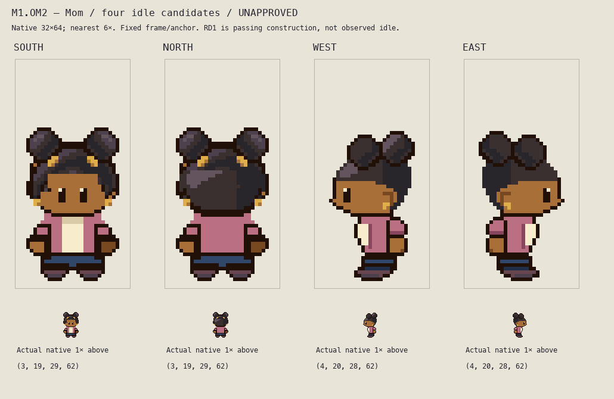

# M1.OM2 — Mom profile far-arm occlusion

**Frozen for coordinator and independent visual review; user appearance acceptance pending. Four idle facings only.**

The concrete OM1 concern was a tiny rose strip in front of the cream top that could read as an extra dangling sleeve. OM2 fully occludes the unsupported profile far arm. The empty `far-arm` semantic layer explicitly records that occlusion; it does not assert recovered hidden anatomy. Actual primary Mom West idle shows a near arm beside the hip without a complete second forward hand. Source skirt and original Critz trousers differ; this is an original occlusion proposal, not a source trace.

Only 12 exposed cells per profile are removed. No surviving pixel is recolored. South/North native PNGs are byte-exact to the copied corrected OM1 checkpoint; every non-far-arm real PNG layer in West/East is byte-exact. Full shoes, near sleeve, rounded 32-cell outlined/16-warm-cell palm, cream torso, head/face, paired puffs, gold earrings, rose cardigan and navy trousers remain exact. No anatomical elongation or shoe resizing occurs. Frame 32×64, anchor (16,64), contact row61 and transparent rows62/63 remain.

[Before/after at native and nearest4×](before-after.png), [native four-facing lineup](idle-native.png), [light/dark native and3× inspection](background-inspection.png), and [countable native-cell grid](idle-grid.png) are regenerated from this single coherent candidate. Historical v0 and corrected v1 sources/boards remain under each owned folder's `history-v0/` and `history-v1/`. Historical builders are archival only and retain old paths; **do not execute historical builders**. Active build and verify paths were migrated before execution.

Editable source is [build.py](../../../art/source/overnight-mom-continuation-r1/build.py), [combined sprite project](../../../art/source/overnight-mom-continuation-r1/mom-four-idles.sprite.json), and per-direction real semantic PNG layers, `layers.json`, and `idle.sprite.json` in `art/source/overnight-mom-continuation-r1/`. [Saved-file checks](../../../art/source/overnight-mom-continuation-r1/saved-file-checks.json) independently decode every layer/project and verify exact recomposition, binary alpha, registration, contact, nearest6×, connected final silhouettes and preserved front shoes: **80 pass**. [Continuation checks](../../../art/source/overnight-mom-continuation-r1/continuation-checks.json): **372 pass**, including all133 old-source/review hash guards, all133 matching checkpoint hashes, unchanged non-far-arm layers and full shoes, connected near sleeve/palm, and each exact changed cell confined to the old far-arm projection. Neither count establishes appearance acceptance.

Bundled Python: `/Users/tanoshi/.cache/codex-runtimes/codex-primary-runtime/dependencies/python/bin/python3`. Run the active `build.py`, `verify.py`, then `continuation-evidence.py` in that source folder. No runtime tests apply to these isolated art exports. The builder regenerates four idle outputs only.

Writer actually viewed final native lineup, complete6× board, native/4× before-after, light/dark native/3× and grid, after viewing `local-review/overnight-cast-qa/primary-idles-native-6x.png`. Mom primary strip pinned revision `5eff78649e7170a877b961ef0b3da13b81a16038`, SHA256 `a404a3c79252a6a13e10622307c3bce4c76c1e1a39814b7c7a11ad7520442289`, index0 transparent, idle0/1/2 and mirrored2; original reference rasters remain outside this review folder. RD1 supplies provisional front visible volume from fan frame2 passing pose, not an observed idle or proven side/back/internal anatomy. Current source/reference limitations remain explicit.

Own visual judgment: extra forward rose/skin projection is absent in both profiles; the cream plane has one continuous outer torso edge and the full near palm remains attached beside the hip. No new concrete defect identified in this bounded correction. Profile hidden anatomy and far shoe remain occluded; no motion, physical-phone or gameplay context test is claimed. Coordinator and human appearance judgment remain separate and pending.

No staging/commit/push, shared-document/generator changes, runtime/saves/editor/deployment, private upload, new characters or walks. Playable build unchanged. Work remains on shared `main`; root owns final source/Git/private Library delivery and shared status. Exact next action: coordinator and independent reviewer inspect frozen OM2, then relay concrete appearance feedback. Walking remains held until explicit root authorization.

Board SHA256: `fca77663ac685f4fa1a6164ccd72b68c4f2562b40316a293d490f636e2a84beb`.
