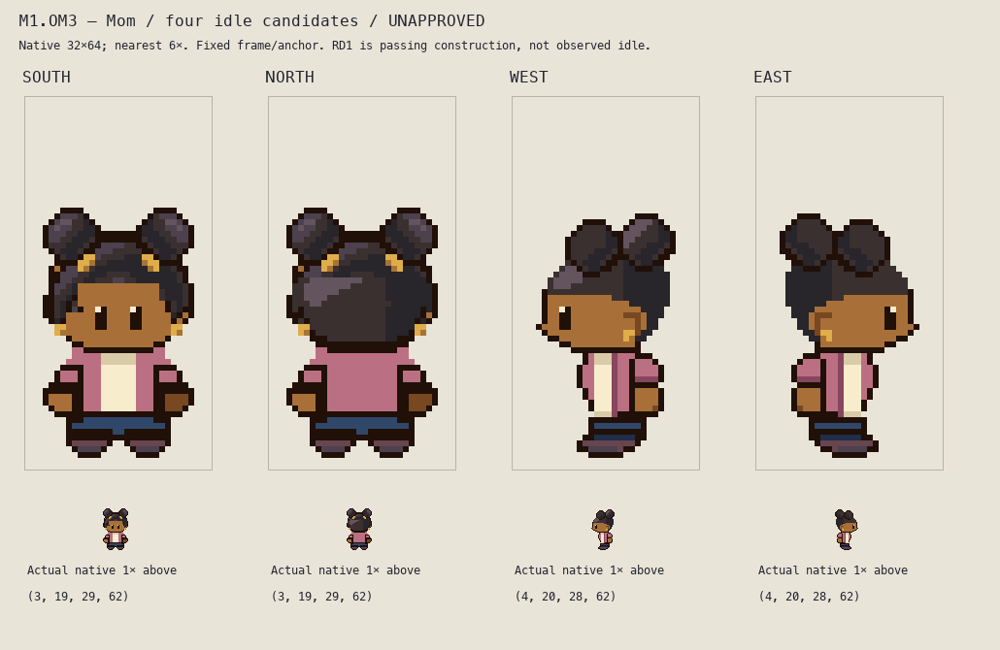

# M1.OM3 — Mom continuous cream inset

**Frozen material-only candidate for root/private parent review. Appearance unapproved; no walking.**

Parent authorized only the cream/cardigan integration correction after actual matched source-facing review. [OVQ2 addendum](../M1-OVQ2/SOURCE-FACING-ADDENDUM.md) identifies the old West torso cream x12–14,y46–49 and x13–14,y50–51, outlined leading rim x11,y46–49. OM3 moves that light material inward and joins it continuously from neckline to waist. The forward garment volume now uses rose, so the cream no longer occupies the short projecting lobe. No body volume is removed.

West cream/cream-shadow occupies x14–16,y44–54 as a single connected inset: shaded collar44–45, light plane46–53, shaded hem54. Rose-shadow atx17 supplies the cardigan opening without a black interior dividing bar. The original outer contour remains unchanged. East is the exact reflected torso wardrobe turn. This is an original costume-plane/readability decision, not recovered source garment geometry or anatomy. South and North remain exact OM2 PNG bytes and all layers.

48 visible torso cells recolored per profile; **zero alpha changes in any frame or semantic layer**. Every non-torso layer remains byte-identical to OM2, including full near sleeve/palm, head/face, hair/puffs/earrings, legs, full feet and empty far arm. Frame32×64, anchor(16,64), whole-body/torso silhouette, heights, contact61 and two empty bottom rows remain exact. Full near palm remains32outlined/16warm cells. No whole-body/shoe shrink, anatomy extension, redesign, palette-family change or variants.

- [Before/after](before-after.png): actual native and nearest4× OM2 versus OM3, West/East.
- [Actual changed-cell map](material-changed-cells.png): only visible changed cells, nearest5×. Exact coordinates/before/after hex colors in [continuation checks](../../../art/source/overnight-mom-inset-r1/continuation-checks.json).
- [Native full-frame lineup](idle-native.png), [light/dark native/3×](background-inspection.png), [countable grid](idle-grid.png).
- [Editable builder](../../../art/source/overnight-mom-inset-r1/build.py), [combined four-idle project](../../../art/source/overnight-mom-inset-r1/mom-four-idles.sprite.json); real per-direction semantic PNG layers, `layers.json`, `idle.sprite.json` under `art/source/overnight-mom-inset-r1/{south,north,west,east}/`.

**80 saved-file checks pass** independently decoding layer PNG/JSON and project pixels, exact composite, native dimensions, binary alpha, connected figure, nearest6× and contact. **538 material/protection checks pass**:341 read-only input-file hashes spanning original OM1 and OM2 namespaces, all layer alpha exact, all other layers exact, combined project exact, exact S/N PNG bytes, every changed cell confined to opaque profile torso material, connected neckline-to-waist cream and exact equivalent East wardrobe turn. Checks establish integrity, not appearance acceptance.

Actual viewing: pinned all-facing primary native/6× plate, matched source-facing reference/candidate board, prior OM2 West6×; then final OM3 complete native128×64, complete6× board, native/4× before-after, light/dark native/3×, changed-cell5× and grid. Primary Mom at revision5eff78649e7170a877b961ef0b3da13b81a16038, strip SHA256 a404a3c79252a6a13e10622307c3bce4c76c1e1a39814b7c7a11ad7520442289, index0 transparent. Raw source palettes are not verified runtime colors; skirt differs from Critz trousers. No source pixels are copied into these outputs. RD1 remains provisional visible FRONT volume from fan frame2 passing, not observed idle or proven profile anatomy. Hidden anatomy is not inferred.

Own visual finding: cream now reads as one continuous inset inside the rose cardigan, rather than the isolated short light lobe. Near palm remains clearly beside the hip. Root/parent must judge this material correction before any walking; this writer does not self-approve art. No emulator, gameplay context, motion or physical-phone test claimed.

Run bundled `/Users/tanoshi/.cache/codex-runtimes/codex-primary-runtime/dependencies/python/bin/python3` with active `art/source/overnight-mom-inset-r1/build.py`, then `verify.py` and `continuation-evidence.py`. Active output paths were migrated before any execution. All `history-*` scripts are **archival only; never execute them**, since their original paths are retained. Original namespaces remain read-only; copied histories including `history-om2/` preserve prior source/evidence.

No shared files/generators, runtime/saves/creator, Git/index/push, upload/deployment, new characters or walks touched. Playable build unchanged. Root owns final source/Git/private Library delivery and shared status. Exact next action: actual root/private parent review of this one frozen corrected family; walking remains held until explicit root authorization.

Board SHA256 `f4373e7557c62cbd6d8459a29b012593e1f1b18788d0794c440bdf75dc9ed431`.
