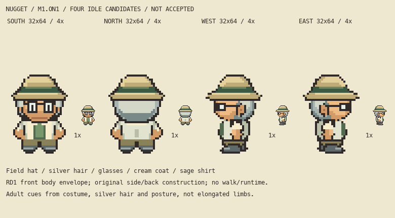

# M1.ON1 — Professor Nugget four-idle candidate

**Current state: corrected idle revision v1, awaiting root visual review. No walking authorization or appearance acceptance.**



The established adult herpetologist/mentor retains C6's field hat, silver hair, glasses, cream field coat and sage shirt. No backpack, new occupation, personal lore or runtime behavior was added. These are isolated original drawings, not gameplay replacements.

## Current deliverables

- `south-idle.png`, `north-idle.png`, `west-idle.png`, `east-idle.png`: transparent native32×64, anchor(16,64), last opaque row61.
- `four-idle-native.png`: actual-size four-direction atlas.
- `four-idle-board.png`: true-native thumbnails and exact nearest4×.
- `four-idle-dark-4x.png`: dark-background material/outline review.
- `four-idle-grid.png`: full native cell grid, x16 centre and Y0-at-bottom ten-row guides.
- `idle-correction-evidence.png`: rejected v0 versus corrected West, true-native/4× plus actual named layer ownership.
- Editable source: `art/source/overnight-nugget-r1/build.py`, ordered sparse RGBA cell JSON per direction and native transparent layer PNGs. JSON exports retain every native cell and exactly recompose. The deterministic build source owns geometry and palette; edits can be made there or to exported layers for subsequent reconciliation. No shared generator is changed.

## Reference basis and limits

Actual writer inspection covered C6's native Nugget PNG at1×/6×, C7's directional source sheet, the original I2 supporting-character study, the current RD1 flat dummy at1×/6×, the actual supplied front frame image and primary native/6× idle strips. The original C6 front uses doubled clusters; this candidate draws native1px curves and overlaps while preserving the costume identity.

RD1 source commit `a25379df5c76fc1d4bf88c02525aef5affa4781c` supplies the current reference-derived **visible front body**, not an approved master. Its source GIF `5fe7935d9f90afbd23530b7a7f57a5147cd1c5142734e0b4306ca71f5666015e`, frame2, is a passing pose, not observed idle. Covered skull crown25 and internal labels remain proposed. Current Nugget front has exact RD1 alpha from row46 down, including full shoes/contact; clothing and face are original. Nugget's hat starts at23, two rows above RD1's proposed crown, without stretching the lower body. Adult cues come from existing costume, silver hair and posture.

Primary Brendan/Man1 strips at `731ad5bfd6e6f265508d0efcca0ba42f9dcf5881` were viewed through `/tmp/ds1-primary-reference/primary-inspection.png`. The later actual all-direction QA plate and Professor Birch strip at `5eff78649e7170a877b961ef0b3da13b81a16038` were also inspected. Birch SHA256 is `6618f1249880bd3672c453512351f63b173cb655fb136ceea84fdb2c9cd76c15`. Birch West idle index2 and side poses7/8 were decoded with palette index0 excluded and actually viewed at native/8× before the side correction. Observed compact head/coat overlap, descending short sleeve/hand, near/far-foot occlusion and heel/toe contacts inform the drawing. They do not prove hidden anatomy or Nugget's clothing dimensions. Reference-colored comparison remains external at `/tmp/nugget-birch-side-actual.png`; no source raster is copied into this review.

Front fan imagery provides **no side/back proof**. Nugget side/back geometry, coat closures, hair overlaps, hat planes and shoe material are original inferred construction from the established costume and inspected primary perspective. East is the explicit reflected West with its own editable layers; Nugget's established costume has no known physical asymmetry. No emulator/frame-capture observations are claimed.

## Actual v0 rejection and bounded correction

Root and parent rejected the first side lower body: long solid platform, oversized pale lens, unclear hand/forearm ownership. Original complete source and all review PNGs are preserved under both assigned namespaces' `history-v0/`; rejected pixels are not discarded or presented as accepted.

Corrected West/East only: tapered trousers/ankle, rounded full near toe, short far heel occluded behind near shoe, compact three-pixel highlight, smaller single near lens/eye and continuous warm forearm under sleeve at the hip. Front and North PNG bytes are unchanged from v0. No invented far eye or projecting nose is introduced.

Actual West alpha runs (half-open): row57 changes `[8,24)`→`[10,22)`;58 `[9,24)`→`[11,22)`;59 `[7,24)`→`[10,23)`;60 `[6,25)`→`[9,22)`;61 contact `[7,23)`→`[10,19)`. The13px widest combined lower contact band and9px last contact now distinguish near shoe/far heel rather than extending across19px. These are original perspective decisions, not mandatory source quotas. Birch actual native rows28/29/30 are recorded separately in `correction-evidence.json`. West105 native RGBA cells changed; East mirrors those changes. Actual visible planes retain substantial feet, with no long shins added.

Writer viewed current four-directions at true native and integer4× on light/dark backgrounds, plus countable grid and v0/v1 actual-layer comparison. The side platform read is reduced; compact glasses and warm arm are clearer. Rear coat stays plain and collar/head overlap is unchanged, avoiding invented decoration. This remains writer assessment for review, not final acceptance. Directional size/pose and charm remain root/parent judgments.

## Validation and handoff

`checks.json` records16 passing focused structural guards: native frame/binary alpha/row61 contact, palette, exact ordered sparse-layer recomposition for all four, front/back alpha symmetry, explicit East correspondence and exact front RD1 body alpha46+. `correction-evidence.json` records actual source rows, changed cells and PNG hashes. These checks do not certify artistic success.

Build with bundled Python containing Pillow:

```sh
/Users/tanoshi/.cache/codex-runtimes/codex-primary-runtime/dependencies/python/bin/python3 art/source/overnight-nugget-r1/build.py
```

Work remains on `main`; starting observed HEAD `967a6ad5aa6820cf268b47fc1deae47005600638`. Root coordinates Git, so this task has not staged, committed, pushed, uploaded or deployed. All writes are confined to the two assigned namespaces. Existing parked/shared edits are preserved; runtime, saves, sprite editor and hosted gameplay are unchanged by this task. No applicable `.agents` directory was found.

Exact next action: root actually reviews the corrected v1 four-idle board and region evidence, gives bounded corrections or an explicit idle-review verdict, then separately coordinates whether walking may begin. Until then four idles only.

### Final saved-file freeze audit

Root actually viewed corrected v1 and reported the compact shoe surface/smaller lens visibly improved, with the pale slab gone; root's final source/layer audit and private delivery remain pending. Writer's independent `audit-freeze.py` now reads the actual saved PNGs and sparse cell files without invoking the generator. **97 guards pass:** every saved layer equals its cell export, all ordered layers reproduce final images exactly, all four visible figures are single four-connected clusters, native atlas slots are exact, and Front/North remain byte-identical to v0. Each side has19 visible warm hand cells in a5×5 bounds region, directly contacting its25-cell visible sleeve. Visible near shoe42 cells/far heel6 cells/short highlight3 cells provide explicit overlap ownership. These are raster observations, not anatomical claims.

`saved-file-audit.json` pins actual source inputs and visible layer ownership. `freeze-manifest.json` freezes185 source/review/history files with SHA256 hashes. There is no known saved-file integrity blocker. Artwork is frozen at four idles awaiting root's actual visual verdict; no walking, Git or publication action is authorized here.
