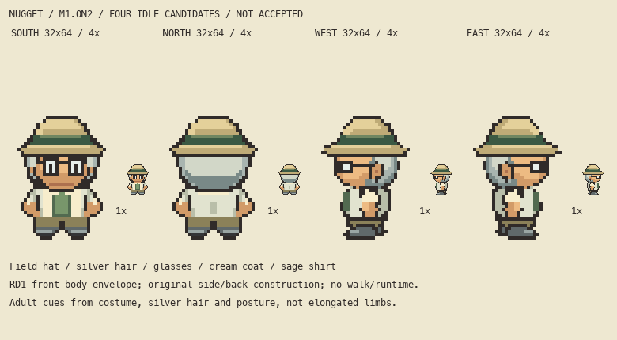

# M1.ON2 — Professor Nugget continuation: four idle facings

**State: frozen for root/parent visual judgment. Appearance acceptance is false. Walks remain unauthorized.**



The corrected v1 South, North, West and East pixels are preserved byte-for-byte. No redraw was needed after current native/integer inspection. The adult herpetologist retains his field hat, silver hair, glasses, cream coat and sage shirt. No pack or new personality was introduced.

## Source and review

Current editable source is `art/source/overnight-nugget-continuation-r1/`: deterministic `build.py`, ordered native RGBA cell JSON, and individually editable transparent semantic PNG layers for every facing. JSON and layer PNGs exactly recompose the exported sprites. The current manifest records 32×64 frames, anchor(16,64), row61 final contact and palette. Source edits belong in this exclusive folder; rebuilding deterministically overwrites its active layer exports.

Review exports include each facing, `four-idle-native.png`, clean native/4× board, dark4× board, countable5× grid (including top64/bottom0, x16 and ten-row labels), and the inherited v0/v1 correction evidence. Both source/review folders retain historical v0 and corrected v1 archives. Historical scripts preserve their original paths as evidence and must not be run. Active scripts assert the new exclusive source and output paths before writing.

## Reference limits and actual inspection

Current continuation inspection covered the actual native128×64 atlas; the full four-idle clean4×, dark4×, grid5× and v0/v1 layer-ownership plate; and `local-review/overnight-cast-qa/primary-idles-native-6x.png` showing actual indexed Brendan, Man1, May, Mom and Birch facings. Source hashes/revisions remain in the pinned QA reference audit and `saved-file-audit.json`. Palette index0 is excluded from primary reference masks. These are raster observations, not emulator observations.

RD1 is provisional visible front volume from supplied fan GIF frame2, a passing pose. It proves no idle, side, back or hidden internal anatomy. South alpha46+ and full shoes58+ remain exact RD1. Side/back construction and clothing boundaries remain original proposals. Birch informs compressed coat/head overlap and foot occlusion; no Birch outfit was copied. Exact underlying garment/limb anatomy remains unresolved.

At actual native size the side eye is a very small dark two-cell feature at West(8,38..39), East(23,38..39), adjacent to the pale lens; both cells survive the final composite. At4× the lens is compact, with no projecting pale slab. Sleeve, warm hand and coat retain distinct visible ownership; each near warm hand has19 visible cells across5×5 bounds and contacts the sleeve. The near shoe is rounded/compact and occludes the far heel; no long shin was introduced. Front shoes and the established head/costume identity are unchanged. This is current writer judgment for root review, not appearance approval. Native eye subtlety and the narrow side silhouette remain points for actual parent judgment.

## Verification

- 16 structural guards: native frames/binary alpha, contact, exact sparse recomposition, palette, front/back alpha symmetry, East reflection, front RD1 envelope.
- 97 independent saved-layer guards: source JSON equals saved layer PNGs, exact ordered recomposition, one four-connected figure per facing, visible hand/sleeve contact and exact atlas slots.
- 304 continuation guards:186 protected old Nugget checkpoint files remain exact; copied v0 history remains exact; all four corrected-v1 native PNGs and semantic cell exports remain exact; visible eye sites, frame/anchor and full front shoe registration pass; active output paths migrated.

The original528-file checkpoint is read-only; the186 Nugget files within it are independently guarded. Other owners may continue their assigned work. `continuation-audit.json` and `saved-file-audit.json` contain the actual named checks. `freeze-manifest.json` records SHA256 for every file in the two exclusive folders except itself, including all retained history. Technical passing counts do not establish artistic acceptance.

Run only active scripts with bundled Pillow Python:

```sh
/Users/tanoshi/.cache/codex-runtimes/codex-primary-runtime/dependencies/python/bin/python3 art/source/overnight-nugget-continuation-r1/build.py
/Users/tanoshi/.cache/codex-runtimes/codex-primary-runtime/dependencies/python/bin/python3 art/source/overnight-nugget-continuation-r1/verify-continuation.py
/Users/tanoshi/.cache/codex-runtimes/codex-primary-runtime/dependencies/python/bin/python3 art/source/overnight-nugget-continuation-r1/audit-freeze.py
```

Branch observed `main`, HEAD `967a6ad5aa6820cf268b47fc1deae47005600638`. Existing unrelated/shared edits were present before work. This continuation writes only its two exclusive folders. No staging/commit/push, shared document/generator edit, Library upload, runtime/save/creator change or deployment was performed; root owns those final actions. Hosted gameplay is unchanged by this task.

Exact next action: root independently inspects the frozen ON2 board/layers/hashes and handles private parent delivery. Parent/user appearance judgment is separate; no walking may begin without explicit root authorization.
