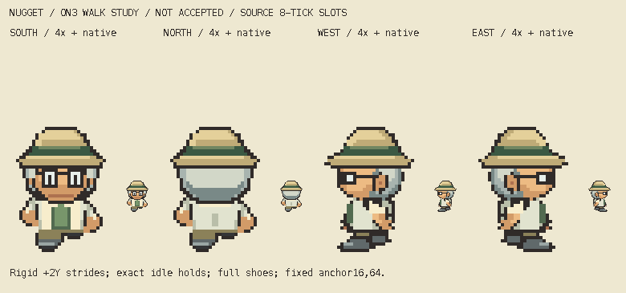

# M1.ON3 — Professor Nugget four-direction walking study

**Corrected v1 is frozen after writer, independent QA and root motion review; parent/user appearance judgment remains open. This is a bounded animation study, not gameplay integration.**



[4× slower paired review](four-directions-slow4x.gif) · [All static phases](all-phases-native-4x.png) · [Art-only local viewer](http://127.0.0.1:8127/)

Four facings each use A → exact ON2 idle → B → exact ON2 idle. The twelve unique transparent32×64 PNGs, native atlas, per-facing1×/4× normal/slow GIFs, paired native/4× animated boards and clean static strip are original character-only outputs. Normal and slow viewing are both available in `index.html`, with pause, restart and phase stepping. The viewer reads these art files only; it has no game or browser-storage access.

## Actual reference and timing

The actual indexed Professor Birch strip at pinned `5eff78649e7170a877b961ef0b3da13b81a16038` is SHA256 `6618f1249880bd3672c453512351f63b173cb655fb136ceea84fdb2c9cd76c15`. Writer inspected all nine relevant frames at native and integer6× before construction. Transparency is derived explicitly from original palette index0, never palette luminance. Numeric frame/contact observations are retained in source `reference-observations.json`; the temporary reference-bearing inspection plate was viewed and removed. No reference raster is retained in this packet, source or public build. This is source-pixel inspection, not emulator observation.

Root independently reopened pinned `sAnim_GoSouth/North/West/East` commands and resolved the early4/6 shorthand as incorrect. This study uses **ordinary8-update holds**, not the separate fast4-update sequence:

| Facing | Actual source order | Observed last source contact: A / B | Proposed Critz last contact: A / B |
| --- | --- | --- | --- |
| South | 3,0,4,0 | row31 x5..7 / x8..10 | row63 x10..13 / x18..21 |
| North | 5,1,6,1 | row31 x5..7 / x8..10 | row63 x10..13 / x18..21 |
| West | 7,2,8,2 | row31 x4..5 / x9..12 | row63 x7..15 / x14..22 |
| East | reflected7,2,8,2 | reflected West | row63 x16..24 / x9..17 |

Coordinates in this table are inclusive native top-down pixel indices. Source idle contact ends30, target idle61; source stride ends31, target stride63. Contact widths describe each saved drawing; they are not shoe-shrinking quotas or claims of exact Birch anatomy. Fixed frame anchor remains(16,64), distinct from last painted contact. RD1 remains provisional front passing-frame visible volume, with no side/back/internal boundary proof.

Exact viewer tick is `280896/16777216` seconds; each slot8ticks≈133.941650ms; full32tick cycle≈535.766602ms. GIF uses nearest cumulative centisecond boundaries: normal `[130,140,130,140]`ms (540ms); inspection4× `[540,530,540,530]`ms (2140ms). The viewer uses the exact source period; GIF rounding is explicitly different. There is no arbitrary800ms cadence.

## Construction and editable source

`art/source/overnight-nugget-walk-r1/` is the exclusive source folder. Each direction has `A.layers.json`, `idle.layers.json`, `B.layers.json` with actual ordered sparse RGBA cells and separately editable semantic native PNG layers. These saved layers exactly recompose each final PNG. `build.py` is a local deterministic authoring source and asserts its exclusive ON3 output paths. It reads ON2 without writing there. Rebuilding resets generated review metadata; perform the saved-file audit and visual review again before any new freeze.

All ON2 input bytes and historical folders remain exact. New idle PNGs and underlying semantic cells equal ON2 exactly. The whole head, hat, glasses, hair and upperbody shift rigidly+2targetY on each stride, corresponding to actual Birch+1sourceY. There is no horizontal head/torso shift, width change, lean, accessory/costume redesign, coat/hair flap or pack. The established adult herpetologist keeps field hat, silver hair, glasses, cream coat and sage shirt.

Front/back full shoe volumes and colors are translated intact, with short source leg material and opposing arm elevation; the sprite is not globally mirrored to change leading feet. Profile full near shoes retain their exact shape/colors and alternate travel. Far full shoe and far arm completion behind the coat are **original proposed hidden construction**, not recovered anatomy or enlargement of ON2's tiny visible far heel. Their visible overlap changes with the stride. Near arm pixels articulate about the same shoulder using an integer native shear; far arm remains behind the coat. No extra shin length is introduced. East is an explicit reflected West with its own editable source; the established costume has no known physical asymmetry.

The visible profile passing overlap remains broad and the side eye subtle at native. The animation introduces the measured two-pixel vertical bob, so charm/bounce and lower-body mass still require actual parent/user judgment. Source correspondence and technical guards cannot approve that appearance.

## Parent rejection and bounded v1 side correction

Parent actually inspected the initially uploaded strip and rejected the nearly black W/E far-foot wedge in A/B. That later appearance finding supersedes the earlier generic source/rendering pass. The complete initial source/review is preserved in `history-v0/` in both owned folders. It is historical/rejected for this treatment, never an accepted motion baseline.

Read-only diagnosis compared actual Birch7/8 with v0 and saved visible layer ownership before editing. The v0 far shoe was a full45cell copy of the near shoe, recolored to shoeDark(52,53,55), not literal ink(48,43,41); its low contrast and excessive far-only travel formed the dark wedge. That hidden construction was my original proposal, not a source fact.

The bounded v1 correction changes only W/E far-shoe/far-leg stride layers: far-only travel moves2targetcells closer under its ankle (A+4→+2, B−3→−1); the existing cool gray(96,105,106) restores the upper above the dark contact. The complete45cell far shoe remains unscaled. Exact full near shoe/positions, head/hat/glasses, arms, torso and all other source layers remain byte-identical; South/North and all idle PNGs are exact initial history. Visible far-shoe cells decrease through occlusion A23→16/B27→21, with8/12 visible gray upper cells. These are observations, not target quotas. Full source contour/volume remains unchanged.

[Original-only v0/v1 proof](side-correction-originals-native-4x.png) shows the correction at native/4× without reference artwork. The actual reference-bearing temporary comparison was separately inspected by writer/QA/root and removed from the owned folders before freeze; root retains source-facing inspection material only in ignored local-review. Numeric diagnosis and correction evidence remain in source JSON.

## Checks and actual review

`audit.py` reads saved outputs independently and records **1,600 passing named guards** in `checks.json`:288 ON2 file-preservation guards; unique/in-frame native source cells and exact PNG/JSON equality; exact layer recomposition of all twelve poses; binary alpha; one four-connected figure each; actual row61/63 and planted-side alternation; exact idle source; rigid source head/hat/eyes/glasses translation; complete normalized source shoe shape/color; native atlas slots; East correspondence; every decoded per-facing and paired GIF frame, transparency/no trails and rounded duration; byte-exact preserved source/PNG history and all non-far-foot layers; full far shoe contour without scaling; actual gray upper survival after occlusion.

Writer actually inspected the whole corrected static native/4× strip, original-only before/after proof and actual Birch/v0/v1/owner comparison. The IAB viewer was freshly reloaded after correction; actual normal/slow4× live samples and held A/B/idle views were inspected, including full-page samples containing all four facings. The corrected viewer ran about25seconds before pausing. This was **sampled live screenshot/phase inspection, not uninterrupted human watching**. The recessed overlap and visible gray upper materially reduce the black wedge; no new concrete construction blocker was identified by writer. Original lower-body mass and charm/bounce remain parent judgments.

Root's earlier rendered audit2,120 matches/64 cross-character cases and initial12Nugget pins describe **historical v0**. The v1 correction intentionally changes W/E A/B only (20/23RGBA cells, reflected East), superseding four old pins; the other eight PNG pins remain exact. Those historical passing counts do not approve corrected appearance. Independent QA inspected the actual v1 source-facing plate and fresh playback samples, confirmed gray upper/recessed overlap and reported no further concrete blocker. Root then actually viewed the corrected source/v0/v1 comparison and its own matched source-before-after, plus fresh Chrome6.5second sampled normal/slow playback across all slots/directions. The current OWR2 rendered audit records3,152 pixel matches across96 cross-character/direction/speed/slot cases, with no failures. These aggregate counts cover three characters. All12current Nugget PNG hashes match its final candidate pins exactly. Root found no additional concrete correction before parent inspection and explicitly requested freeze; no appearance approval follows.

`artwork-lock.json` and `freeze-manifest.json` pin the current outputs/source after that final root review. No art or loop changed after the final rendered capture. Technical and coordinator review remain separate from parent/user acceptance.

## Handoff and exact next action

Observed branch `main`; HEAD during verification `317fe6c4f7d070f883a85ed49b9f129cafa3143f` (root may advance it independently). Existing shared and other-owner changes are preserved. This writer performed no Git staging/commit/push, private upload, shared document/generator edit, runtime/save/creator/deployment action. Root owns final source/Git/private Library delivery. Hosted gameplay is unchanged by this study.

Root's next action is to update the existing three Nugget private review identities with corrected v1 plus the source comparison and collect actual parent/user feedback. Independent technical/motion review is complete for this frozen candidate. Any later correction needs a concrete finding. No further character, run cycle, world work or gameplay adoption follows automatically.

Reproduce only inside these exclusive namespaces:

```sh
/Users/tanoshi/.cache/codex-runtimes/codex-primary-runtime/dependencies/python/bin/python3 art/source/overnight-nugget-walk-r1/build.py
/Users/tanoshi/.cache/codex-runtimes/codex-primary-runtime/dependencies/python/bin/python3 art/source/overnight-nugget-walk-r1/audit.py
python3 -m http.server 8127 --bind 127.0.0.1 --directory docs/reviews/M1-ON3
```
