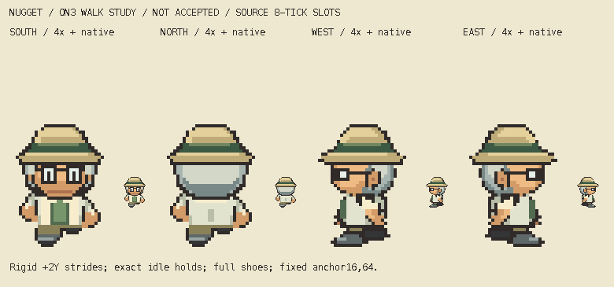

# M1.ON3 — Professor Nugget four-direction walking study

**Frozen for root/parent visual review. This is a bounded animation study, not final appearance acceptance or gameplay integration.**



[4× slower paired review](four-directions-slow4x.gif) · [All static phases](all-phases-native-4x.png) · [Art-only local viewer](http://127.0.0.1:8127/)

Four facings each use A → exact ON2 idle → B → exact ON2 idle. The twelve unique transparent32×64 PNGs, native atlas, per-facing1×/4× normal/slow GIFs, paired native/4× animated boards and clean static strip are original character-only outputs. Normal and slow viewing are both available in `index.html`, with pause, restart and phase stepping. The viewer reads these art files only; it has no game or browser-storage access.

## Actual reference and timing

The actual indexed Professor Birch strip at pinned `5eff78649e7170a877b961ef0b3da13b81a16038` is SHA256 `6618f1249880bd3672c453512351f63b173cb655fb136ceea84fdb2c9cd76c15`. Writer inspected all nine relevant frames at native and integer6× before construction. Transparency is derived explicitly from original palette index0, never palette luminance. Numeric frame/contact observations are retained in source `reference-observations.json`; the temporary reference-bearing inspection plate was viewed and removed. No reference raster is retained in this packet, source or public build. This is source-pixel inspection, not emulator observation.

Root independently reopened pinned `sAnim_GoSouth/North/West/East` commands and resolved the early4/6 shorthand as incorrect. This study uses **ordinary8-update holds**, not the separate fast4-update sequence:

| Facing | Actual source order | Observed last source contact: A / B | Proposed Critz last contact: A / B |
| --- | --- | --- | --- |
| South | 3,0,4,0 | row31 x5..7 / x8..10 | row63 x10..13 / x18..21 |
| North | 5,1,6,1 | row31 x5..7 / x8..10 | row63 x10..13 / x18..21 |
| West | 7,2,8,2 | row31 x4..5 / x9..12 | row63 x7..15 / x14..22 |
| East | reflected7,2,8,2 | reflected West | row63 x16..24 / x9..17 |

Coordinates in this table are inclusive native top-down pixel indices. Source idle contact ends30, target idle61; source stride ends31, target stride63. Contact widths describe each saved drawing; they are not shoe-shrinking quotas or claims of exact Birch anatomy. Fixed frame anchor remains(16,64), distinct from last painted contact. RD1 remains provisional front passing-frame visible volume, with no side/back/internal boundary proof.

Exact viewer tick is `280896/16777216` seconds; each slot8ticks≈133.941650ms; full32tick cycle≈535.766602ms. GIF uses nearest cumulative centisecond boundaries: normal `[130,140,130,140]`ms (540ms); inspection4× `[540,530,540,530]`ms (2140ms). The viewer uses the exact source period; GIF rounding is explicitly different. There is no arbitrary800ms cadence.

## Construction and editable source

`art/source/overnight-nugget-walk-r1/` is the exclusive source folder. Each direction has `A.layers.json`, `idle.layers.json`, `B.layers.json` with actual ordered sparse RGBA cells and separately editable semantic native PNG layers. These saved layers exactly recompose each final PNG. `build.py` is a local deterministic authoring source and asserts its exclusive ON3 output paths. It reads ON2 without writing there. Rebuilding resets generated review metadata; perform the saved-file audit and visual review again before any new freeze.

All ON2 input bytes and historical folders remain exact. New idle PNGs and underlying semantic cells equal ON2 exactly. The whole head, hat, glasses, hair and upperbody shift rigidly+2targetY on each stride, corresponding to actual Birch+1sourceY. There is no horizontal head/torso shift, width change, lean, accessory/costume redesign, coat/hair flap or pack. The established adult herpetologist keeps field hat, silver hair, glasses, cream coat and sage shirt.

Front/back full shoe volumes and colors are translated intact, with short source leg material and opposing arm elevation; the sprite is not globally mirrored to change leading feet. Profile full near shoes retain their exact shape/colors and alternate travel. Far full shoe and far arm completion behind the coat are **original proposed hidden construction**, not recovered anatomy or enlargement of ON2's tiny visible far heel. Their visible overlap changes with the stride. Near arm pixels articulate about the same shoulder using an integer native shear; far arm remains behind the coat. No extra shin length is introduced. East is an explicit reflected West with its own editable source; the established costume has no known physical asymmetry.

The visible profile passing overlap remains broad and the side eye subtle at native. The animation introduces the measured two-pixel vertical bob, so charm/bounce and lower-body mass still require actual parent/user judgment. Source correspondence and technical guards cannot approve that appearance.

## Checks and actual review

`audit.py` reads saved outputs independently and records **1,339 passing named guards** in `checks.json`:288 ON2 file-preservation guards; unique/in-frame native source cells and exact PNG/JSON equality; exact layer recomposition of all twelve poses; binary alpha; one four-connected figure each; actual row61/63 and planted-side alternation; exact idle source; rigid source head/hat/eyes/glasses translation; complete normalized source shoe shape/color; native atlas slots; East correspondence; every decoded per-facing and paired GIF frame, transparency/no trails and rounded duration.

Writer actually inspected the whole static native/4× strip, native atlas, and live IAB normal/slow4× viewer samples and held phases, including full-page samples containing all four facings. The viewer ran about30seconds before pausing; this was **sampled live screenshot/phase inspection, not uninterrupted human watching**. Feet/arms visibly alternate, head/hat remain rigid, and no new concrete construction defect was identified. Root separately inspected all12static poses and live normal/slow samples. Its rendered audit records2,120 pixel matches over64 cross-character/direction/speed/slot cases with no failures; all12current Nugget PNG hashes were independently rechecked against its `candidatePins`. Those aggregate counts cover Girl and Nugget, not Nugget alone.

Root requested artwork freeze after that actual review. PNGs/GIFs have not changed since its capture. `artwork-lock.json` pins immutable review image outputs. `freeze-manifest.json` pins all source/review files except itself. Technical and coordinator review remain separate from parent/user acceptance.

## Handoff and exact next action

Observed branch `main`; HEAD during verification `317fe6c4f7d070f883a85ed49b9f129cafa3143f` (root may advance it independently). Existing shared and other-owner changes are preserved. This writer performed no Git staging/commit/push, private upload, shared document/generator edit, runtime/save/creator/deployment action. Root owns final source/Git/private Library delivery. Hosted gameplay is unchanged by this study.

Root's next action is to finish independent motion review/private delivery and collect actual parent/user feedback. Any later correction needs a concrete finding. No further character, run cycle, world work or gameplay adoption follows automatically.

Reproduce only inside these exclusive namespaces:

```sh
/Users/tanoshi/.cache/codex-runtimes/codex-primary-runtime/dependencies/python/bin/python3 art/source/overnight-nugget-walk-r1/build.py
/Users/tanoshi/.cache/codex-runtimes/codex-primary-runtime/dependencies/python/bin/python3 art/source/overnight-nugget-walk-r1/audit.py
python3 -m http.server 8127 --bind 127.0.0.1 --directory docs/reviews/M1-ON3
```
