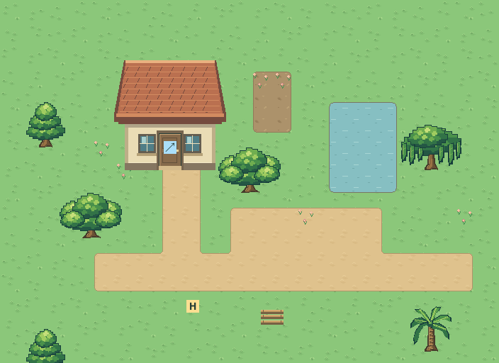
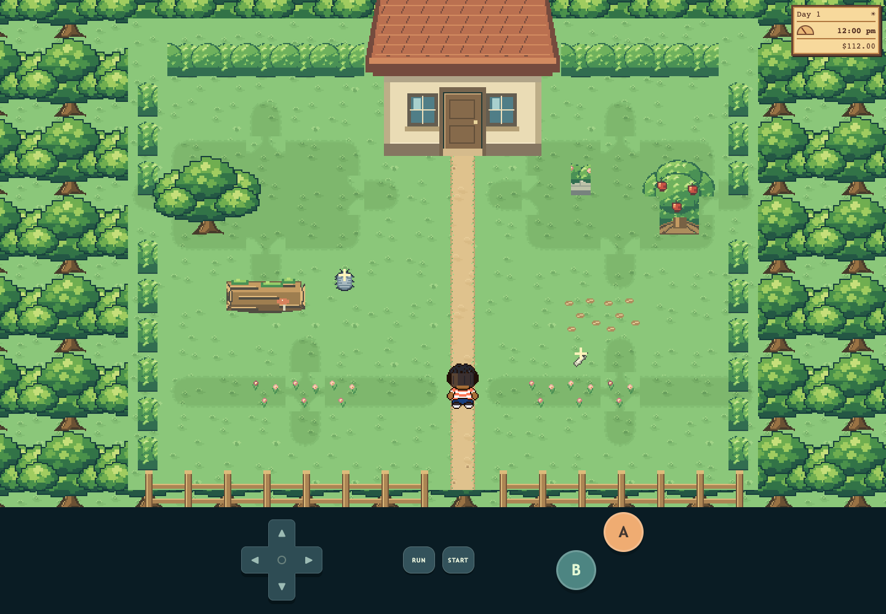

# M1.OV1 — Rootport Grove and Button's quiet corner

First overnight visual slice, 2026-10-13. Implemented in local adventure and Map Studio under the user's expanded redesign authorization. New appearances await morning visual feedback; technical checks do not imply wider visual or movement acceptance.

Repository: `/Users/tanoshi/Documents/ChatGPT/Critz-Tycoon`, `main`. Opening checkpoint: `eae476c1edcb6fa61cf847f2a44d6f2151ed2920`, clean. Art bible is authoritative: 2× means twice linear resolution (four times area); UI2 uses a 480×320 baseline and expands adventure FOV to the display. No Emerald art or audio was imported.

## What changed

- Adventure trees now draw the selected original TR2 transparent PNGs from explicit ground footprints. Grove crowns replace broadleaf trees, cedars replace cypress trees, and nearby-water trees use willows. All existing solid cells, maps and save coordinates are preserved. Fruit trees retain their previous working ripe/shake bank.
- Map Studio offers all four native trees, with full transparent thumbnails and a live placement ghost. The red overlay marks the two solid cells separately from the canopy. Existing tree/cypress project semantics remain compatible; willow/palm are new available styles.
- Garden soil no longer reads as wooden boards. A shared original quiet-earth bank contains all 47 joining contexts over unchanged Critz grass/path/paving/sand underlays. Runtime and editor use the same exports.
- The editor toolbox's existing 320px overflow is fixed with two-column narrow-phone tools and readable controls.
- Button receives a honey-colored native whorl, gliding foot waves and attached eyestalks. Eight glide poses retain the previous 72-source-tick loop. Look, nibble and rest actions use 12 additional poses. Human sprites and approved Hero V1 remain unchanged.
- The local review presents a three-observation notebook vignette, not a new persistent rescue/catching system. It reuses accepted original track 03, “A Button with Feet,” only after a user click. Review audio settings and observations are in memory.

## Try the slice locally

With the existing preview server on port5197:

- [Button review](http://localhost:5197/art-review/grove.html)
- [Walk through Rootport Grove](http://localhost:5197/map-editor/?review=grove&play=1)
- [Edit Rootport Grove](http://localhost:5197/map-editor/?review=grove)
- [Actual adventure](http://localhost:5197/)

The garden is an isolated authoring/test scene with a cottage and reciprocal room link; it does not create a new adventure area or overwrite a saved map draft. The original hosted phone game has not been redeployed by this batch. Parent coordinates any later Sites publication.

[Same-state before](adventure-yard-before.png) · [Button poses at exact6×](button-poses-6x.png) · [Pixel-grid review](button-grid.png) · [Placement ghost](tree-placement-ghost.png) · [320px editor](editor-320x568.png).

## Usable assets and sources

- `src/tree-art.js` is the shared native tree placement/selection renderer. TR2 source PNGs/metadata remain unchanged in `assets/review/trees-r2/` and `art/source/trees-r2/`.
- `assets/playable/button-v2/` contains twenty native PNGs, four GIFs and the runtime atlas. `art/source/button-v2/` contains deterministic original authoring, indexed pixels and exact RLE.
- `assets/playable/soil-v2/` contains the native atlas and stable-ID metadata. `art/source/soil-v2/` contains the deterministic authoring script and four reopenable 47-frame indexed families.
- Both authoring scripts reuse installed Sharp and the actual Sprite Editor exporter, through `CODEX_PRIMARY_RUNTIME_NODE_MODULES`. No packages were installed.

## Verification

248 unit tests pass, including tree placement/serialization checks. Syntax and `git diff --check` pass. Local build succeeds and verifies all thirty accepted MIDI assets.

[Independent Button report](native-checks.json): all20 native PNGs equal indexed/RLE source and atlas crops; binary alpha, connected appendages, stable shell, source cadence and exact approved Hero hash pass. All20 decoded GIF frames equal their source pixels.

[Independent soil report](soil-checks.json): all188 editable frames equal native atlas pixels; all65,536 four-by-four terrain layouts pass1,048,576 shared-edge comparisons.

[Release-browser checks](release-browser/browser-checks.json): observation completion, accepted MIDI fetch/toggle, unchanged synthetic storage, four searchable native tree styles, canopy/blocker preview, actual garden walking, eight independently layered tree front/behind pixel comparisons, actual adventure loading, matched noon before/after captures, 320/390px portrait and844px landscape layouts, and no page errors/missing assets. All22 existing editor and9 adventure integration scenarios pass. Their reports are retained alongside this packet. The adventure harness initially spawned inside the unchanged Luke sign blocker; its fixture now asserts a clear approach and verifies the actual upward entry. Browser contexts are synthetic and isolated; no real saves were used.

Visually inspected native/enlarged Button poses, garden ground/tree composition, actual adventure before/after and the corrected320px editor. Physical iPhone Safari, audible listening on the user's speakers and the wider visual/feel gates remain untested/unaccepted.

## Archive and next ownership

[Archive audit](archive-audit.json) records four ignored CPython caches moved reversibly to `archive/overnight-2026-10-13/generated-caches/`, with original paths, byte hashes and restore instructions. These archived cache bytes remain local and ignored; the manifest is versioned. Every linked source, music and historical art download remains in place.

After the batch checkpoint, editor/model/render ownership is released to parent and the editor audit worker. `src/world-water.js` was never edited. Next priorities from that audit are raw override traversal/render consistency, local water underlays and pond depth isolation, water compilation cost, unreachable passage/water validation, stale return links after resize, and footprint-only tree placement. They are not claimed fixed here.

Morning questions: Does the grove/willow/cedar family fit Rootport at play scale? Should the older fruit-tree crown be redrawn into this family next? Does Button's larger whorl and restrained movement read clearly in the field guide? These are optional visual decisions, not overnight blockers.

Validated runtime commit `929a23345d4269393ce375adcce3bea400d06499` is pushed to verified `FreeMarketWildlife/Critz-Tycoon` `origin/main`, with matching remote SHA and a clean runtime checkpoint. [Receipt](checkpoint.json). This final receipt changes documentation only. Editor/model/render ownership is released; no further source edits by this batch.
