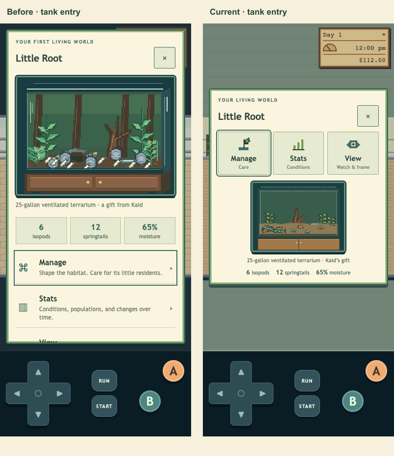

# M1.OV2 — Little Root care and native home/orchard art

Implemented under the next overnight request. This slice puts tank care ahead of browsing, preserves all gameplay/save behavior and supplies original native home assets. New appearance awaits morning feedback; no wider visual/feel acceptance or Sites deployment is claimed.

## Gameplay-facing changes

- Tank entry contains exactly **Manage / Stats / View**, with all three visible at320×568,390×844,844×390 and desktop. Native care/chart/view icons and a compact live preview keep the place readable. No fourth first-level action remains.
- The ten-critters/three-habitats collection still opens from View and Glow n’ Blow. B returns to the originating View/shop; framing, capture and posting remain available.
- Mist, litter, moss and cleaning are grouped above light/ventilation settings. Inventory/cost/disabled states and44px targets remain. Paper-window body copy and captions have stronger contrast.
- Little Root's native soil/moss/litter/hide/glass and small decomposer poses make condition changes visible. Rendering consumes state without changing simulation. Aquarium/paludarium gallery demonstrations and all field-guide species stay available; no owned aquarium-care system or new species was invented.
- Furniture is independently authored on the target grid: bed, desk, sofa, counter, shelves, table, fern and rug. Frame sizes retain the exact doubled existing allocations; original maps/collision/interaction cells stay fixed. Transparent native props register their contact to the existing B plane and sort with the unchanged actor ordering. Quiet structural backdrop replaces dark room margins without creating walkable areas or changing UI2 FOV.
- All four existing fruit trees draw Grove-family bare/ripe art, with the same64×96 contact entries, root edge, fruit centers, fixed-root/shaking-crown split, three-apple pickup and24-hour regrowth. The shared contact sheet/editor metadata remains unchanged.

33 native assets, individual PNGs, editable indexed projects, original generator and runtime atlas live in `assets/playable/home-v2/` and `art/source/home-v2/`. The source reads no reference-game raster. Hero Boy V1 and existing human/animal source banks remain intact. All original30 accepted MIDI assets remain untouched.

## Visual evidence

Matched noon,390px synthetic saves; actual screenshot pixels inspected. The before bank is the first-slice sourcef0a6b31; the current bank is this tested release. These are browser views, not physical iPhone/Safari captures.

[Everyday care before/after](02-care-before-after.png) · [Home before/after](03-home-before-after.png) · [Orchard before/after](04-orchard-before-after.png) · [Downstairs phone](downstairs-phone.png) · [Downstairs native framebuffer](downstairs-native.png).

The entry preview is deliberately small; View retains the full detail/framing presentation. Expanded phone FOV still shows structural margins and repeated outdoor border trees; wider authored composition remains future work. Existing stair art also remains a future visual consistency target. These are visual priorities, not broken care/menu/save controls left for morning.

## Checks and isolation

`native-checks.json` independently compares every one of33 PNGs with editable indexed source and runtime atlas pixels; binary alpha, orchard y16/y80 registration and exact approved Hero hash pass. No scene/care/fruit/geometry source was changed outside the owned presentation modules.

The initial task-only release from137c753 passes262 unit checks and44 browser groups:8 focused menu/care/gallery/save/fruit,10 existing living/capture/shop,9 full-screen/control/save-error and17 full opening/rescue/shop/care/Critter/loan/save/input scenarios. Both optional-loan paths preserve the25-gallon gift and all animals. A stale walkthrough BFS ignored existing fence-edge barriers; its owned test helper now follows actual traversal instead of asking movement to cross fences. Gameplay traversal was not changed.

The final combined release uses the separately completed editor HEADd79ee5e. Final combined checks pass276 units,33 native exports and53 unique relevant browser groups; the focused8 home/care and9 integration groups pass again against the combined build. All1,360 runtime/asset files equal the tested source. Exact counts and blocked checkpoint receipt are recorded in `validation.json`/`checkpoint.json`. Release snapshots were built from committed HEAD plus only this slice's files, so the other worker's unfinished edits were never packaged or staged. Fresh synthetic browser contexts only; no real saves accessed. Physical Safari and audible speaker listening remain untested.

## Ownership and delivery

Owned modules: `src/main.js`, `src/render.js`, `src/tank-render.js`, `src/contact-art.js` (fruit-image override only), `src/home-art.js`, `style.css`; owned asset/review directories; focused home/living/adventure tests and this task's canonical documentation sections. No map-editor, world-water/coastal files or editor-worker tests were edited. Contact geometry, save/care/fruit rules, world-space and maps are unchanged.

Parent coordinates phone-site publication. Screenshot Library saving remains blocked by the previously reported required-workflow limitation; images are preserved locally and in this packet, with no alternate upload route attempted.

Next meaningful direction: deepen the View habitat composition/behavior and decide whether the next gameplay milestone is bringing Pebble home or adding aquarium care. The immediate tank-menu usability bugs are resolved; no user decision is needed to keep the repaired loop playable.

## Checkpoint blocker

Automatic approval review rejected both scoped main-commit attempts before execution. The retry supplied the later parent delegation and exact user transcript authorizing main commits/pushes; the reviewer still treats retrieved authorization as untrusted and requires separate trusted approval. No staging, commit, push or deployment occurred. All task changes remain available locally; the pending editor regression edits are excluded from this validated release. Parent must supply fresh direct authorization or checkpoint the owned-path slice itself. No workaround was attempted. [Receipt](checkpoint.json).
