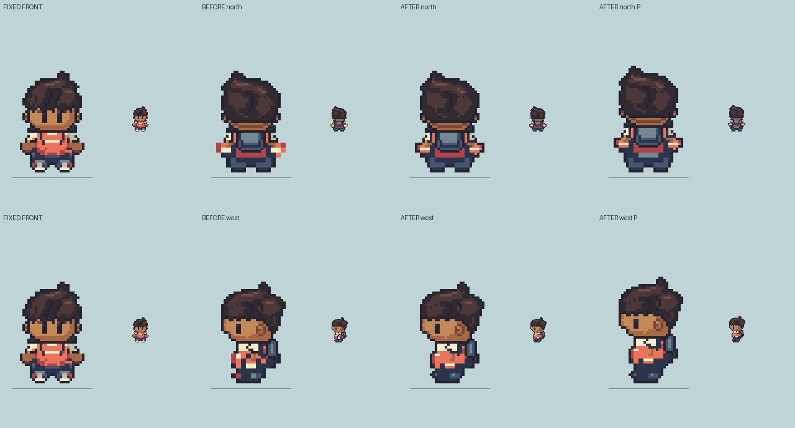

# M1.PS1 — Native-grid side/back sprite correction

**Current visual review candidate; scale and full bald foundation not self-approved.** Direct user authorization identifies this writer and requests fixing side/back mixed pixel scale while preserving the front, continuing under Eutychus, finishing the bald dummy first, then the creator. Review-only source/art; no gameplay, save or deployment change.

## Source finding and correction

HR14's North/West/East upper/lower key tables duplicate adjacent rows in pairs, while the custom South construction uses native row changes. The final HR14 painter already introduces some native outline pixels, so this is not a claim that every old rendered pixel was a2×2 block or every contour had a2px stroke. The remaining contour/material repetition made the side/back body read coarser than the retained native head/front. ART_BIBLE's existing one-native-pixel outline rule forbids forced block-grid construction, not coherent solid color clusters.

PS1 draws native silhouette steps in the existing side/back lower envelopes, keeps/refines a single native exterior boundary, quiets doubled white sleeve slabs, gives the upper torso clear original coral fabric rather than navy/white glove-like patches, and places smaller native near-tip material cues. All four front Hero poses are exact. Every selected head/hair/eye and visible hand pixel remains exact, along with the lowest contact row and all occupied contact pixels,32×64 frame,16,64 anchor, existing phase order/ticks and original canonical pack/straps. New lower contour changes are original refinement decisions, not exact reference-alpha claims. Contact widths remain image-plane costume contours, not measured bare feet.

[Exact changed cells](../../../art/source/hero-scale-r1/changes.json). Changes by pose idle/A/P/C: North40/33/40/31, West46/65/47/59, East46/65/47/59; South0/0/0/0. Alpha edits are bounded native contour cuts/steps in side/back only; no image rescaling/filtering, no hair/body enlargement. One-row fabric highlights and near-tip accents retain the selected outfit palette. The original HR14 files remain unchanged; this separate candidate is not silently accepted gameplay art.

## Reviewable static and motion evidence

- Per-direction `south/north/west/east-unique-review.png`: each existing idle/A/P/C, before Hero, after Hero, matching independent bald base, exact layer recomposition; native and nearest3×.
- Per-direction `{normal,slow}-{1x,4x}.gif`: BEFORE Hero | AFTER Hero | BALD BASE. Eight original phase slots, loop0. South800/3200ms; NWE540/2160ms retain existing export rounding. These are not new emulator-timing observations.
- [Local review page](preview.html) serves native/exact4× normal and labelled slow previews.
- Actual independent body/costume RGBA/masks and single-garment removal views: [NB3 candidate](../M1-NB3/README.md).

[295 saved source/layer/connection/GIF checks](checks.json) pass; all16 Hero palettes remain within the current15-color budget.21 native editor projects validate (five Hero walk/idle projects plus16 neutral stills). All GIFs decode pixel-exact in all8 slots/delays. The prior South NB1 foundation's32 PNGs remain byte-exact. Actual body/garment composites reproduce every corrected Hero pose exactly; exposed body contribution is disjoint from clothes. Bald crowns do not inherit hair/fringe/headwear.

Owner inspected all unique side/back stills and native/enlarged before/after plates. Current browser playback was sampled for front/back; no uninterrupted full-cycle human-watch claim. The broad profile passing costume mass remains a visual concern even after the native detail refinement; a technical contact match cannot settle its artistic weight. Full bald gait/limb depth/proportions and scale consistency remain for Eutychus's independent review. Old Library/render receipts refer to earlier art and are not current approval evidence.

Exact next action: independent current side/back scale and full bald-body pose review, bounded corrections as identified, then the user-authorized creator after foundation confirmation. No creator implementation has started. Root owns Library replacement/review receipts. Parked shared-document/HR11 changes and prior NB1/NB2 evidence are preserved.
