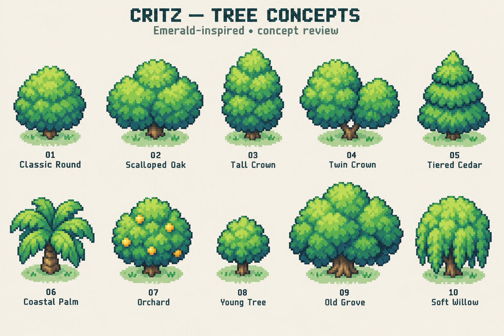

# M1.TR1 — Ten tree concepts

2026-10-11. Concept deliverable only; awaiting user visual review. The user rejects the existing trees and requests ten different concepts referencing Pokémon Emerald.

1. Classic Round
2. Scalloped Oak
3. Tall Crown
4. Twin Crown
5. Tiered Cedar
6. Coastal Palm
7. Orchard
8. Young Tree
9. Old Grove
10. Soft Willow

Built-in imagegen produces one comparison sheet with ten designs. This is enlarged concept art, not a verified native sprite bank or working atlas. No selected tree, collision change, animation or gameplay replacement is implied. Art direction and reference interpretation are centralized in ART_BIBLE. Full generation prompt: [prompt.txt](prompt.txt).

Reference: existing [pinned Emerald environment study](../../reference-data/EMERALD_ENVIRONMENT_RESEARCH.md), pret/pokeemerald revision `5eff78649e7170a877b961ef0b3da13b81a16038`. That study inspected source assemblies, not emulator frames. No new reference pixel measurements or emulator capture are claimed. The attempted online primary atlas URL did not resolve; the existing pinned study remains the reference basis.

Next action: user chooses preferred numbered silhouettes or requests revisions before native asset production. Wider M1/M2 gates remain awaiting user approval. Playable build and existing saves remain unchanged; no deployment is required for this standalone review packet.
