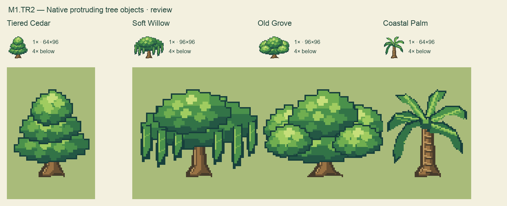
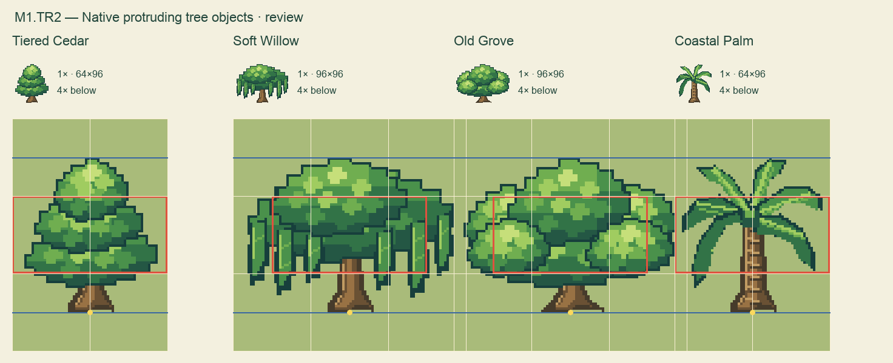

# M1.TR2 — Four native protruding tree objects

Native asset delivery complete; **awaiting user visual review**. The user selects Tiered Cedar, Soft Willow, Old Grove and Coastal Palm from TR1 and requests real pixel models, explicit canvas/collision separation and a protruding-object contract. Their follow-up requests wider canvases for willow and grove.

| Model | Native PNG | Editable pixel project |
| --- | --- | --- |
| Tiered Cedar | [PNG](../../../assets/review/trees-r2/tiered-cedar.png) | [Project](../../../art/source/trees-r2/tiered-cedar.sprite.json) |
| Soft Willow | [PNG](../../../assets/review/trees-r2/soft-willow.png) | [Project](../../../art/source/trees-r2/soft-willow.sprite.json) |
| Old Grove | [PNG](../../../assets/review/trees-r2/old-grove.png) | [Project](../../../art/source/trees-r2/old-grove.sprite.json) |
| Coastal Palm | [PNG](../../../assets/review/trees-r2/coastal-palm.png) | [Project](../../../art/source/trees-r2/coastal-palm.sprite.json) |

Canonical dimensions, registration, contact and terminology are in [ART_BIBLE](../../ART_BIBLE.md#protruding-objects--sprite-overhang-and-ground-footprint-m1tr2). Machine-readable placement/collision is in [objects.json](../../../assets/review/trees-r2/objects.json). No labels, grids or grass are baked into asset PNGs. Preview ground is presentation only.

Authored directly on the native pixel grid with connected stepped polygons and leaf planes, not by shrinking/quantizing the TR1 concept sheet. The pinned Emerald study remains `5eff78649e7170a877b961ef0b3da13b81a16038`; no new reference measurements or emulator observation are claimed. Transparent PNG sprites plus explicit anchors/footprints are the recommended Critz approach for these raised objects. Terrain keeps its tile system; sprites can be packed into an atlas without changing that distinction.

Checks: [independent native report](native-checks.json) passes dimensions, binary alpha, halfway vertical extent, explicit two-cell collision, anchors, exact editor-source/PNG equality, connected art and preserved ground under transparent pixels. All four projects pass the actual Sprite Editor model validator. Native and4× registration plates inspected. A palm trunk/crown gap and isolated vein pixels were corrected before final checks. No runtime tree integration, actor-depth/movement test, save test or physical-phone test is claimed. No gameplay code or accepted art is replaced; no deployment is required for this standalone source/review packet. Existing hosted game remains available at https://critz-tycoon.freemarketwildlife.chatgpt.site.

Next action: user reviews these native appearances and the halfway registration, then requests refinements or accepts them before gameplay/editor integration. M1/M2 visual and movement gates remain with the user.
